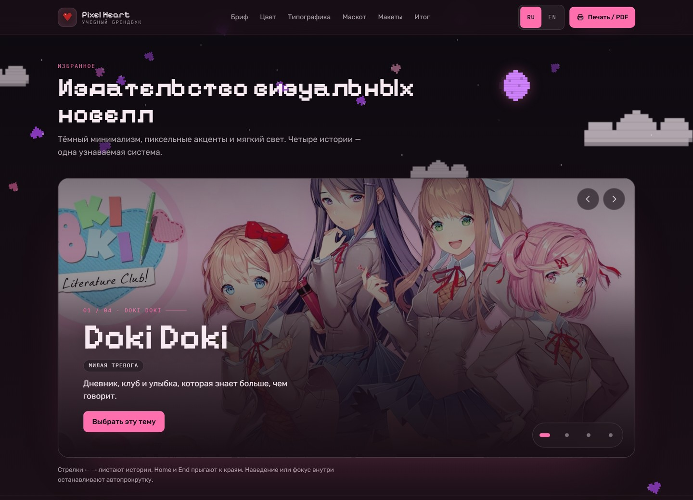
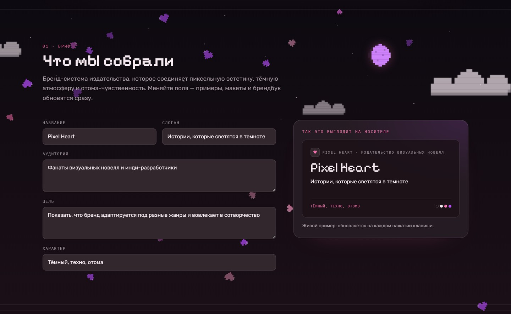
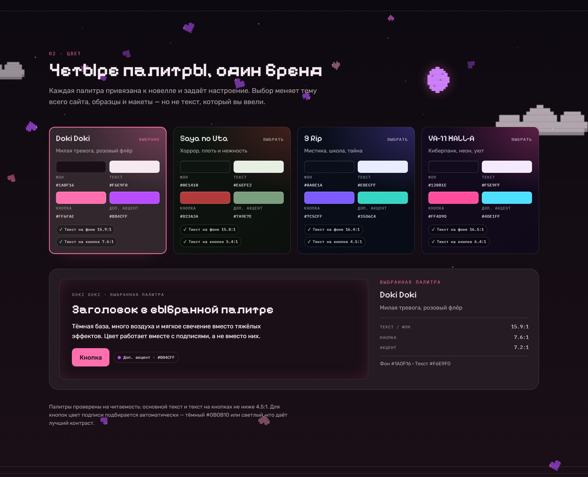
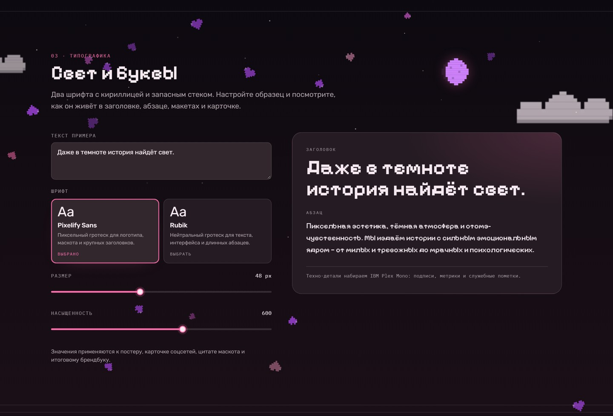
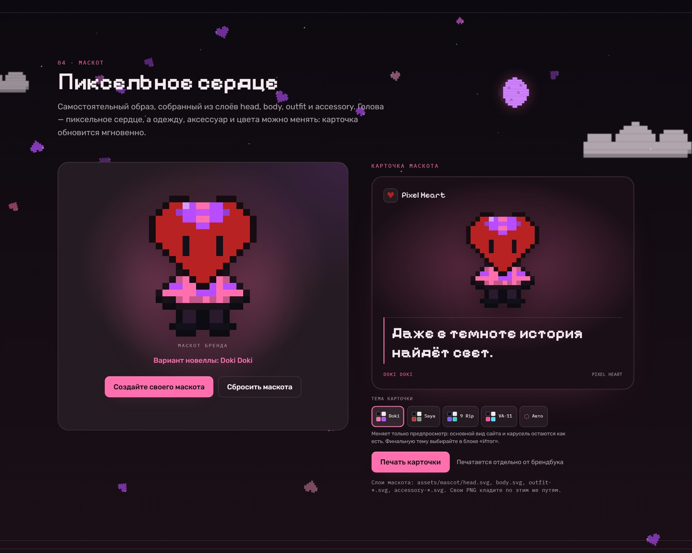
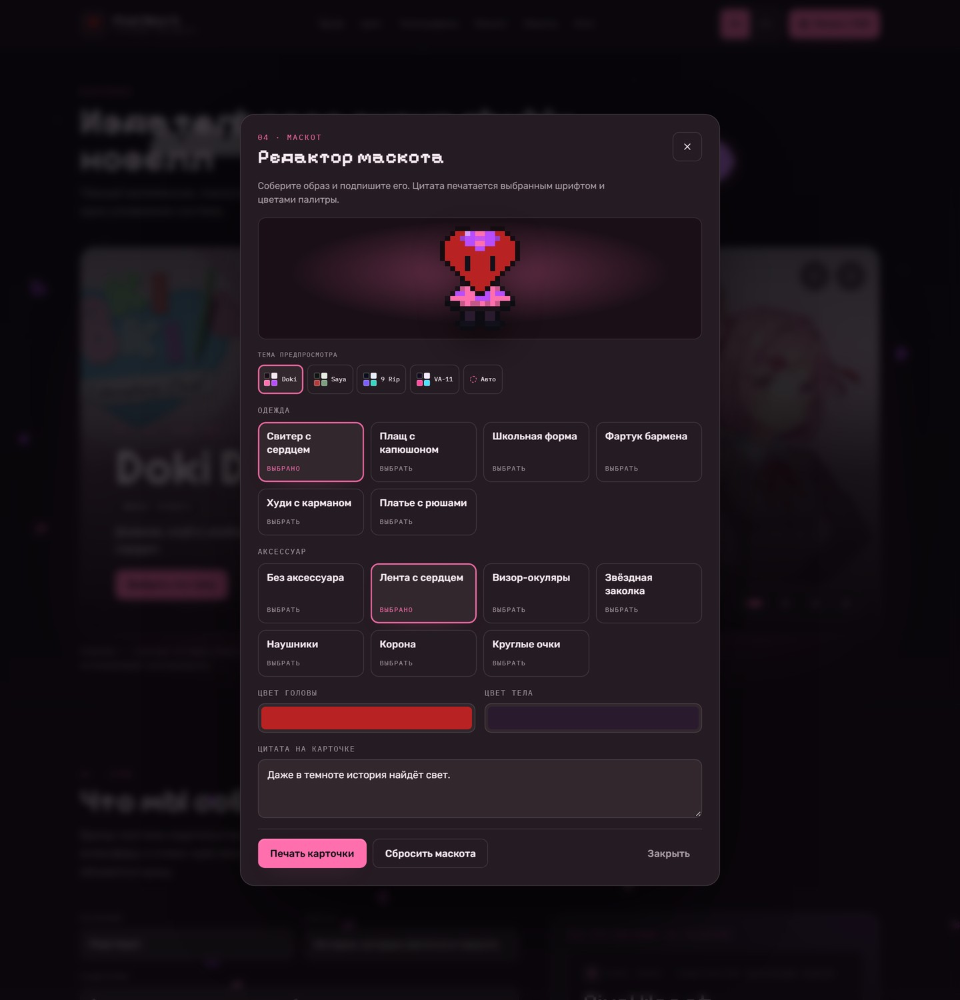
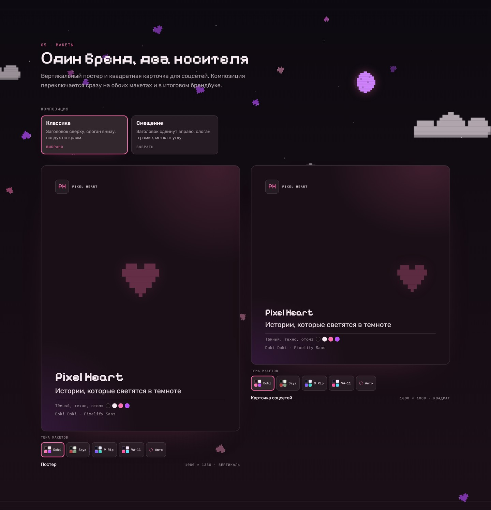
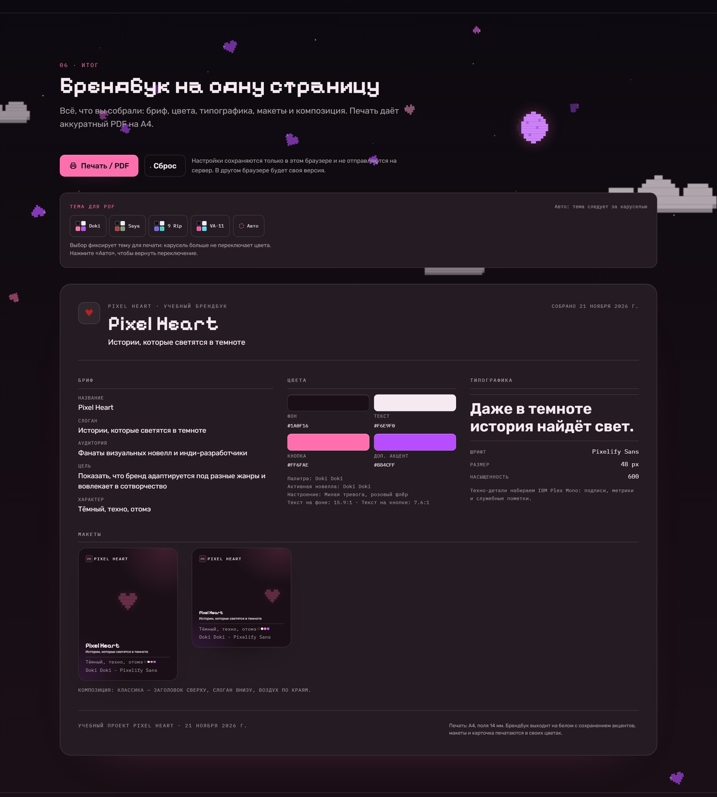
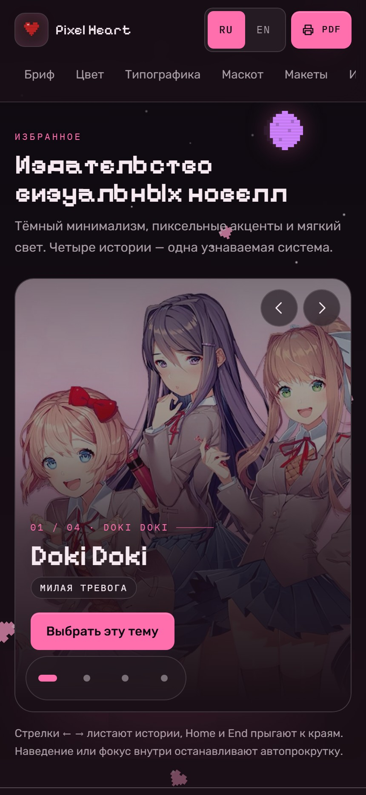
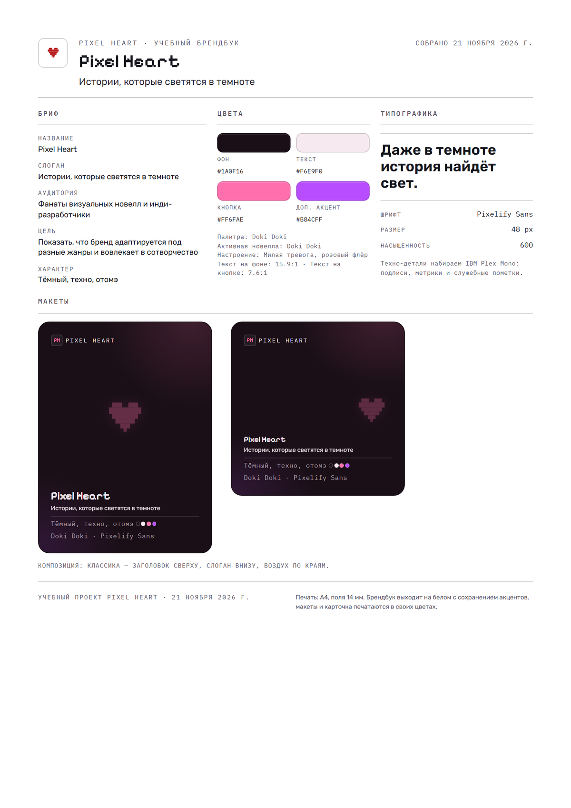

<p align="center">
  
</p>

<h1 align="center">Pixel Heart</h1>

<p align="center">
  <b>Интерактивный брендбук издательства визуальных новелл</b><br />
  Тёмный минимализм, пиксельные акценты и четыре истории, которые светятся в темноте.
</p>



<details>
<summary><b>Содержание</b></summary>

- [Что это](#что-это)
- [Идея](#идея)
- [Для кого](#для-кого)
- [Что умеет сайт](#что-умеет-сайт)
- [Как это работает](#как-это-работает)
- [Экскурсия по странице](#экскурсия-по-странице)
  - [Фон: ночное небо и лепестки](#фон-ночное-небо-и-лепестки)
  - [Шапка и навигация](#шапка-и-навигация)
  - [Карусель историй](#карусель-историй)
  - [Бриф](#бриф)
  - [Цвет](#цвет)
  - [Типографика](#типографика)
  - [Маскот](#маскот)
  - [Макеты](#макеты)
  - [Итог](#итог)
  - [Подвал и служебные сообщения](#подвал-и-служебные-сообщения)
  - [Мобильная версия](#мобильная-версия)
- [Печать и PDF](#печать-и-pdf)
- [Язык и сохранение](#язык-и-сохранение)
- [Как открыть сайт](#как-открыть-сайт)
- [Технологии](#технологии)
- [О проекте и правах](#о-проекте-и-правах)

</details>

---

## Что это

**Pixel Heart** — одностраничный сайт-конструктор айдентики. На нём живёт вымышленное издательство визуальных новелл, у которого есть название, слоган, четыре истории, четыре палитры, свой маскот и два носителя фирменного стиля.

Сайт не показывает «готовый бренд» как картинку в портфолио. Он отдаёт бренд-систему в руки: вы меняете название и слоган, выбираете палитру и шрифт, собираете маскота из одежды и аксессуаров — и сразу видите, как это выглядит в карточке бренда, в постере, в карточке для соцсетей и в итоговом брендбуке.

В конце всё это можно напечатать или сохранить в PDF: одна страница A4, аккуратная сетка, живые цвета.

Проще говоря, это **витрина бренд-системы и одновременно мини-редактор**: посетитель за пару минут проходит путь арт-директора — от брифа до готового PDF.

## Идея

Издательство Pixel Heart соединяет три вещи, которые обычно живут порознь:

- **пиксельную эстетику** — логотип-сердце, pixel-art лепестки, облака, маскот и пиксельный шрифт;
- **тёмную атмосферу** — ночное небо, глубокие фоны, мягкое свечение вместо тяжёлых эффектов;
- **отомэ-чувственность** — нежность, тревога и внимание к эмоции, а не к экшену.

Четыре истории издательства — это четыре настроения, и каждое задаёт свою палитру. Переключение истории меняет не только картинку в карусели, но и цвет всего сайта: небо, кнопки, карточки, макеты, маскота и печать.

| История | Настроение | О чём |
| --- | --- | --- |
| **Doki Doki** | Милая тревога | Дневник, клуб и улыбка, которая знает больше, чем говорит. |
| **Saya no Uta** | Хоррор | Мир стал другим — и в нём всё ещё есть нежность. |
| **9 Rip** | Мистика | Девять причин остаться после уроков. |
| **VA-11 HALL-A** | Киберпанк | Бар, где наливают свет и слушают тишину. |

Главная мысль сайта: **один бренд может звучать по-разному и оставаться узнаваемым**. Одна форма, четыре палитры, четыре настроения — и ни один экран не выпадает из системы.

## Для кого

- **Фанатам визуальных новелл** — посмотреть, как выглядит издательство, которое могло бы выпускать их любимые истории, и собрать собственный вариант айдентики.
- **Инди-разработчикам и небольшим студиям** — примерить на себя готовую бренд-систему: что писать в брифе, как связать палитру с настроением, как выглядит постер и карточка для соцсетей.
- **Дизайнерам и студентам** — разобрать на живом примере, как работают токены цвета, контраст, типографическая шкала и сетка носителей.
- **Тем, кто собирает портфолио** — пройти путь «бриф → палитра → шрифт → маскот → макеты → PDF» и показать результат.

Специальных знаний не нужно: все подписи на русском (есть английский), поля подсказывают, что вводить, а результат виден мгновенно.

## Что умеет сайт

- **Четыре палитры** с проверенным контрастом — от розовой тревоги до неонового киберпанка.
- **Живой бриф** — название, слоган, аудитория, цель и характер сразу попадают в макеты и брендбук.
- **Типографика на выбор** — два шрифта, размер и насыщенность, которые применяются ко всем носителям.
- **Конструктор маскота** — пиксельное сердце в шести нарядах, с семью аксессуарами и своими цветами.
- **Два носителя** — вертикальный постер и квадратная карточка для соцсетей, в двух композициях.
- **Брендбук на одну страницу** — всё собранное в одном документе, с датой и подписью.
- **Печать / PDF** — аккуратный A4 с полями 14 мм; карточка маскота печатается отдельно.
- **Сохранение в браузере** — черновик не теряется между визитами, аккаунт не нужен.
- **Два языка** — RU и EN, переключаются на лету.
- **Аккуратные детали** — клавиатурная навигация в карусели, видимые фокусы, подписи для скринридеров, уважение к `prefers-reduced-motion`.

## Как это работает

1. **Полистайте истории.** Карусель на первом экране показывает четыре новеллы; каждая переключает палитру всего сайта.
2. **Заполните бриф.** Название и слоган — обязательные, аудитория, цель и характер — по желанию. Карточка-мемо справа обновляется на каждом нажатии клавиши.
3. **Выберите цвет.** Четыре палитры с HEX-кодами и бейджами контраста; выбранная сразу примеряется к заголовку, абзацу и кнопке.
4. **Настройте типографику.** Введите свой текст, выберите Pixelify Sans или Rubik, подберите размер и насыщенность.
5. **Соберите маскота.** Одежда, аксессуар, цвета головы и тела, цитата на карточке.
6. **Посмотрите макеты.** Постер и карточка соцсетей в композиции «Классика» или «Смещение».
7. **Заберите результат.** В блоке «Итог» нажмите «Печать / PDF» — и сохраните брендбук в PDF или на бумаге.

Всё, что вы меняете, связано между собой: правка в брифе видна в макетах и в брендбуке, смена палитры перекрашивает небо и кнопки, а шрифт из типографики живёт в постере, карточке и цитате маскота.

## Экскурсия по странице

Сайт — одна длинная страница. Ниже — все её блоки по порядку, как они встречаются при прокрутке.

### Фон: ночное небо и лепестки

За всем содержимым лежит закреплённая сцена — она не двигается при прокрутке и не мешает читать:

- **Небо** — ровный градиент от зенита к горизонту, редкие звёзды и мерцающая группа звёзд.
- **Облака** — три пиксельных облака разного размера медленно плывут слева направо и уходят за край.
- **Луна** — пиксельная, идёт по полукругу от правого края к левому и по дороге меняет фазу: от тонкого серпа к полнолунию и обратно.
- **Лепестки** — падают поверх неба и ложатся сугробом на «землю» у нижней кромки. Их форма зависит от палитры: у Doki Doki падают сердца, у Saya no Uta — длинные лепестки, у 9 Rip — ромбы, у VA-11 HALL-A — неоновые плюсы.
- **Маскоты-дворники** — вдоль нижней кромки иногда проходят четыре маскота, по одному на новеллу: двое подметают лепестки мётлами, двое просто прыгают. Встретившись, они останавливаются и обмениваются короткими репликами в облачках.

Вся сцена декоративная: она не перехватывает клики, скрыта от скринридеров и полностью убирается при печати. Если в системе включено уменьшение движения, лепестки и облака замирают, а маскоты не выходят.

### Шапка и навигация

Липкая полупрозрачная шапка с размытием — она остаётся на экране при прокрутке:

- **Логотип** — пиксельное сердце и название, рядом подпись «учебный брендбук». Клик возвращает наверх страницы.
- **Шесть якорей** — «Бриф», «Цвет», «Типографика», «Маскот», «Макеты», «Итог». На узких экранах строка прокручивается горизонтально.
- **Переключатель языка** — RU / EN.
- **Кнопка «Печать / PDF»** — всегда под рукой, в правом верхнем углу.

### Карусель историй

Первый экран: надзаголовок «Избранное», крупный заголовок «Издательство визуальных новелл» и короткое объяснение концепции. Под ним — карусель из четырёх слайдов.

Каждый слайд — это мини-обложка истории:

- заставка новеллы;
- индекс «01 / 04» с названием;
- крупное имя истории;
- жанровый тег: «милая тревога», «хоррор», «мистика», «киберпанк»;
- одна фраза о настроении;
- кнопка **«Выбрать эту тему»**.

Кнопка делает две вещи: переключает палитру сайта на эту историю и ведёт к брифу, чтобы сразу начать собирать бренд.

Карусель листается стрелками и точками, сама меняет слайд раз в несколько секунд и останавливается, если навести курсор или поставить фокус внутрь. С клавиатуры работают ← и →, а Home и End прыгают к краям. Смена слайда обновляет палитру всего сайта и — пока маскота не настраивали вручную — переодевает его в образ этой новеллы.

Если тема зафиксирована для PDF (об этом ниже), слайды продолжают листаться, но цвета остаются прежними: «Выбрать эту тему» — осознанный способ сменить зафиксированную палитру.

### Бриф

Первый содержательный блок — **«Что мы собрали»**. Слева форма, справа живая карточка-мемо.

**Поля брифа:**

- **Название** — обязательное. Подставляется в лого, постер, карточку и брендбук.
- **Слоган** — обязательный. Держит все макеты: он есть в мемо, постере, карточке соцсетей и брендбуке.
- **Аудитория** — кому говорит бренд.
- **Цель** — что бренд должен сделать.
- **Характер** — три слова через запятую («тёмный, техно, отомэ»).

**Карточка-мемо** показывает, как бриф выглядит на носителе: лого, подпись «Pixel Heart · издательство визуальных новелл», название выбранным шрифтом, слоган, характер и три цветные точки палитры. Она обновляется на каждом нажатии клавиши — это самый быстрый способ увидеть, «как звучит» придуманное название.

Пустые название и слоган не блокируют ввод, но при уходе из поля подсвечивают ошибку и подсказывают, что дописать. Длинный текст переносится, контейнеры растягиваются, ничего не обрезается.



### Цвет

Блок **«Четыре палитры, один бренд»** — сердце системы.

Четыре карточки, по одной на историю. В каждой:

- название и настроение палитры;
- четыре образца с HEX-кодами: фон, текст, кнопка, дополнительный акцент;
- два бейджа контраста — «Текст на фоне» и «Текст на кнопке»;
- подпись состояния: «Выбрано» или «Выбрать».

| Палитра | Настроение | Фон | Текст | Акцент | Второй акцент |
| --- | --- | --- | --- | --- | --- |
| Doki Doki | Милая тревога, розовый флёр | `#1A0F16` | `#F6E9F0` | `#FF6FAE` | `#B84CFF` |
| Saya no Uta | Хоррор, плоть и нежность | `#0E1410` | `#E6EFE2` | `#B23A3A` | `#7A9E7E` |
| 9 Rip | Мистика, школа, тайна | `#0A0E1A` | `#E8ECFF` | `#7C5CFF` | `#35D6C4` |
| VA-11 HALL-A | Киберпанк, неон, уют | `#120B1E` | `#F5E9FF` | `#FF4D9D` | `#4DE1FF` |

Ниже — большой пример выбранной палитры: заголовок, абзац и кнопка в реальных цветах, рядом панель с названием палитры, настроением, HEX-кодами и теми же значениями контраста.

Выбор палитры меняет тему всего сайта, образцы, макеты и предпросмотр маскота, но **не трогает текст**, который вы ввели. Палитры проверены на читаемость: основной текст и подписи на кнопках не ниже 4.5:1, а цвет подписи на кнопке подбирается автоматически — тёмный или светлый, что даёт лучший контраст.



### Типографика

Блок **«Свет и буквы»** отвечает за то, как звучит текст. Слева настройки, справа живой образец.

- **Текст примера** — впишите свою фразу вместо демонстрационной.
- **Шрифт** — две карточки: **Pixelify Sans** (пиксельный гротеск для логотипа, маскота и крупных заголовков) и **Rubik** (нейтральный гротеск для текста, интерфейса и длинных абзацев). Обе поддерживают кириллицу.
- **Размер** — ползунок от 16 до 96 px.
- **Насыщенность** — от 300 до 800.

Образец показывает выбранный шрифт сразу в двух ролях: крупным заголовком и абзацем. Отдельной строкой идёт служебная заметка, набранная IBM Plex Mono, — так в системе выглядят подписи, метрики и технические пометки.

Значения размеров и насыщенности не остаются в образце: они применяются к постеру, карточке соцсетей, цитате маскота и итоговому брендбуку.



### Маскот

Блок **«Пиксельное сердце»** — про характер бренда в буквальном смысле. Слева сцена с маскотом, справа его карточка.

**Маскот** собран из слоёв: тело, одежда, голова-сердце и аксессуар. На сцене он стоит в мягком свечении, под ним подпись «Маскот бренда» и название текущего варианта. Кнопки: **«Создайте своего маскота»** (открывает редактор) и **«Сбросить маскота»**.

**Карточка маскота** — это готовый носитель: лого и название сверху, маскот в центре, цитата выбранным шрифтом и в цветах палитры, внизу название новеллы и марка «PIXEL HEART». Под карточкой — переключатель **«Тема карточки»** (меняет только предпросмотр, сайт остаётся как есть) и кнопка **«Печать карточки»**: она печатает только карточку, отдельно от брендбука.



**Редактор маскота** открывается модальным окном и даёт полный контроль:

- **Одежда** — шесть вариантов: свитер с сердцем, плащ с капюшоном, школьная форма, фартук бармена, худи с карманом, платье с рюшами.
- **Аксессуар** — семь вариантов: без аксессуара, лента с сердцем, визор-окуляры, звёздная заколка, наушники, корона, круглые очки.
- **Цвет головы и цвет тела** — свой оттенок для каждой части.
- **Цитата на карточке** — короткая фраза, которая печатается выбранным шрифтом.

Редактор закрывается кнопкой, по Esc и по клику на фон, а фокус после закрытия возвращается на кнопку открытия — окно не «теряет» клавиатуру.



Пока маскота не настраивали вручную, смена истории или палитры надевает на него одежду и аксессуар этой новеллы: на теме Saya no Uta не остаётся банта Doki Doki.

### Макеты

Блок **«Один бренд, два носителя»** показывает, как система живёт на реальных форматах.

Сначала выбирается **композиция**:

- **Классика** — заголовок сверху, слоган внизу, воздух по краям.
- **Смещение** — заголовок сдвинут вправо, слоган в рамке, метка в углу.

Дальше два макета:

- **Постер** — 1080 × 1350, вертикаль.
- **Карточка соцсетей** — 1080 × 1080, квадрат.

В обоих есть метка «PH», название бренда, слоган, характер, палитра и шрифт, а также цветные точки палитры. Композиция переключается сразу на обоих макетах и в итоговом брендбуке, а вот тема макетов меняется отдельно: переключатель под макетом красит только предпросмотр, не задевая сайт.

Макеты мгновенно реагируют на всё, что вы сделали раньше: на название и слоган из брифа, на палитру, на шрифт, размер и насыщенность из типографики.



### Итог

Блок **«Брендбук на одну страницу»** собирает всё в один документ.

Сверху — панель действий:

- **«Печать / PDF»** — открывает системный диалог печати, откуда документ сохраняется в PDF.
- **«Сброс»** — возвращает демо-данные.
- примечание о том, что настройки живут только в этом браузере и никуда не отправляются.

Ниже — **«Тема для PDF»**: четыре палитры и кнопка «Авто». Выбор фиксирует цвет для печати, и карусель больше не может поменять цвета в момент сохранения. Рядом статус: «Авто: тема следует за каруселью» или «Тема зафиксирована: …». Кнопка «Авто» возвращает переключение.

Сам **брендбук** выглядит как аккуратный документ:

- шапка с логотипом, названием, слоганом и датой сборки;
- блок **«Бриф»** — название, слоган, аудитория, цель, характер;
- блок **«Цвета»** — четыре образца с HEX и справка: палитра, активная новелла, настроение, контраст;
- блок **«Типографика»** — образец заголовка, шрифт, размер, насыщенность и заметка про моно-шрифт;
- блок **«Макеты»** — уменьшенные постер и карточка соцсетей;
- строка композиции;
- подпись «Учебный проект Pixel Heart», дата и примечание о печати.



### Подвал и служебные сообщения

В подвале — логотип и подпись бренда, оговорка об использовании историй, примечание о том, что черновик живёт в локальном хранилище браузера, и кнопка сброса. Там же указано, что проект учебный.

Внизу экрана появляются короткие служебные сообщения: «Черновик восстановлен из этого браузера», «Сохранено 12:34», «Демо-данные восстановлены» и подсказки, если браузер не может сохранить черновик. Сообщение можно закрыть вручную или дождаться, пока оно исчезнет само.

### Мобильная версия

На телефоне страница перестраивается в одну колонку: шапка складывает навигацию в горизонтальную прокрутку, форма брифа и карточка-мемо встают друг под другом, палитры и макеты — в один столбец, а карусель занимает почти весь экран. Тексты и кнопки остаются крупными, сцена с лепестками становится реже, маскоты-дворники — мельче.

<p align="center">
  
</p>

## Печать и PDF

Печать — полноценная часть продукта, а не побочный эффект:

- **Формат A4, поля 14 мм.** Брендбук печатается на белом листе тёмным текстом, но акценты палитры сохраняются.
- **Постер, карточка соцсетей и карточка маскота** печатаются в своих цветах — это отдельные носители, и они не превращаются в чёрно-белую схему.
- **Карточка маскота печатается отдельно** от брендбука: кнопка «Печать карточки» оставляет на листе только её.
- **Декоративная сцена** — небо, лепестки, маскоты, облака — на печать не попадает, поэтому PDF остаётся чистым.
- **Тема для PDF** фиксируется заранее, чтобы цвет не «уехал» в момент сохранения.

Как получить PDF: «Печать / PDF» → в диалоге печати выбрать «Сохранить как PDF» → сохранить.

<p align="center">
  
</p>

## Язык и сохранение

**Языки.** Переключатель RU / EN в шапке меняет подписи интерфейса и демонстрационные тексты. То, что вы ввели сами, остаётся как есть — сайт не переводит ваш бриф.

**Сохранение.** Черновик автоматически сохраняется в локальном хранилище браузера и восстанавливается при следующем визите — с сообщением об этом. Ни сервера, ни аккаунта, ни отправки данных нет: в другом браузере или на другом устройстве будет своя версия. Кнопки «Сброс» в блоке «Итог» и в подвале возвращают демо-данные и удаляют черновик.

## Как открыть сайт

Сайт статический: сборка не нужна, файлы отдаются как есть. Локально достаточно любого статического сервера — из-за ES-модулей открывать `index.html` двойным кликом (`file://`) не получится:

```bash
# из папки проекта
python -m http.server 8000
# затем открыть http://localhost:8000/
```

**Публикация на GitHub Pages:** Settings → Pages → Source: *Deploy from a branch* → Branch: `main`, folder `/ (root)` → Save. Пути в проекте относительные, поэтому сайт работает и в подпапке вида `https://user.github.io/pixel-heart/`.

## Технологии

Коротко, без подробностей: чистые **HTML, CSS и JavaScript** с ES-модулями — без фреймворков, сборщиков и бэкенда. Единственный внешний запрос — Google Fonts (Pixelify Sans, Rubik, IBM Plex Mono); у всех шрифтов есть запасные стеки, поэтому сайт остаётся работоспособным и без них.

## О проекте и правах

Pixel Heart — **учебный проект**. Это брендбук вымышленного издательства, который использует четыре реальные визуальные новеллы как учебную стилизацию: **Doki Doki**, **Saya no Uta**, **9 Rip** и **VA-11 HALL-A**.

Проект не выдаёт себя за официальные сайты игр. Названия, логотипы и изображения принадлежат правообладателям; материалы используются некоммерчески, в учебных целях. Скриншоты в этом README сняты с текущей версии сайта на демо-данных.
