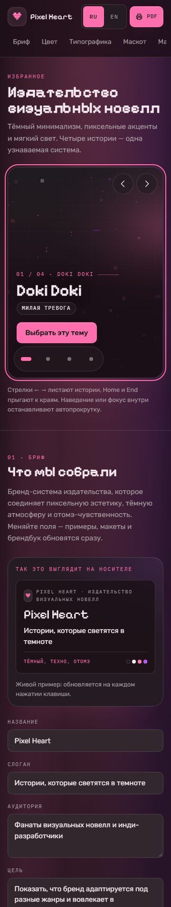
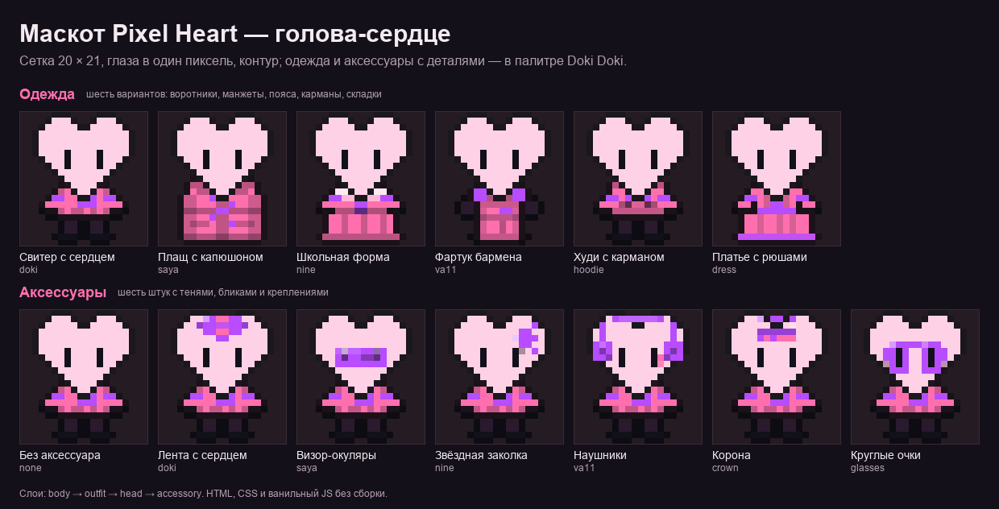

# Pixel Heart — учебный брендбук издательства визуальных новелл

Одностраничный интерактивный брендбук: тёмный минимализм, пиксельные акценты,
четыре палитры-новеллы, маскот, которого можно собрать самому, два макета и
печать на A4.

**Стек:** HTML, CSS, ванильный JavaScript с ES-модулями. Без React, npm,
сборщиков, сервера, регистрации и внешних API. Единственный внешний запрос —
шрифты Google Fonts (Pixelify Sans, Rubik, IBM Plex Mono); у всех есть
локальные fallback-стеки, поэтому сайт работает и без них.

---

## 1. Запуск

ES-модулям нужен `http://`, а не `file://`. Любой статический сервер подойдёт:

```bash
# из корня проекта
python -m http.server 8137
# затем открыть http://localhost:8137/
```

Варианты без Python:

```bash
php -S localhost:8137
# или расширение Live Server в VS Code: правый клик по index.html → Open with Live Server
```

Сборка не нужна: файлы отдаются как есть.

### Публикация на Pages

Пути в проекте относительные, поэтому сайт работает и в подпапке
`https://user.github.io/pixel-heart/`.

- **GitHub Pages:** Settings → Pages → Source: *Deploy from a branch* →
  Branch: `main`, folder `/ (root)` → Save.
- **GitLab Pages:** Settings → Pages → включить, затем добавить `.gitlab-ci.yml`
  с артефактом `public/` (см. фрагмент ниже) и положить туда файлы проекта.
- **GitVerse Pages:** аналогично GitLab — статический артефакт из CI.

```yaml
# .gitlab-ci.yml — минимальный статический деплой
pages:
  stage: deploy
  script:
    - mkdir -p public
    - cp -r index.html css js assets public/
  artifacts:
    paths:
      - public
  only:
    - main
```

Никаких абсолютных путей от корня диска в проекте нет.

---

## 2. Структура файлов

```
pixel-heart/
├── index.html                  # одна страница со всеми секциями и якорями
├── css/
│   ├── common.css              # токены, типографика, шапка, кнопки, поля, подвал
│   ├── sky.css                 # ночное небо: градиент, звёзды, облака, луна
│   ├── petals.css              # лепестки, нижняя земля и маскоты-дворники
│   ├── hero.css                # карусель, слайды, точки, плейсхолдер
│   ├── brief.css               # форма брифа и живая миниатюра
│   ├── color.css               # карточки палитр, образцы, контраст
│   ├── typography.css          # контролы и живой образец
│   ├── mascot.css              # сцена, карточка, модальный редактор
│   ├── layouts.css             # постер, карточка соцсетей, композиции
│   ├── final.css               # итоговый брендбук
│   └── print.css               # @media print: A4 и режим печати карточки
├── js/
│   ├── data.js                 # новеллы, палитры, шрифты, маскот, композиции, i18n
│   ├── state.js                # demoState, getState/setState/subscribe/resetState
│   ├── storage.js              # localStorage-черновик, debounce, коды статусов
│   ├── theme.js                # палитра → CSS-переменные, расчёт контраста
│   ├── i18n.js                 # t(), pick(), перевод статической разметки
│   ├── utils.js                # escapeHtml, debounce, форматирование, фокус
│   ├── app.js                  # точка входа: загрузка, тема, язык, печать, сброс
│   ├── petals.js               # сцена: лепестки, сугроб на земле, маскоты с мётлами
│   ├── sky.js                  # луна: движение по дуге и смена фаз
│   ├── hero.js                 # карусель: авто, пауза, клавиатура, точки
│   ├── brief.js                # поля брифа, валидация, миниатюра
│   ├── color.js                # выбор палитры, бейджи контраста, мини-пример
│   ├── typography.js           # шрифт, размер, насыщенность, образец
│   ├── mascot.js               # inline SVG маскота, редактор, карточка, печать
│   ├── layouts.js              # постер и карточка соцсетей
│   ├── final.js                # итоговый брендбук
│   └── themepicker.js          # мини-переключатели темы и фиксация темы для PDF
├── assets/
│   ├── logo.svg                # самостоятельный пиксельный логотип
│   ├── novels/                 # doki.png, saya.png, nine.png, va11.png + README
│   └── mascot/                 # README со спецификацией слоёв и путями для PNG
├── tools/
│   ├── make-placeholders.py    # генератор временных абстрактных заставок
│   └── verify.mjs              # служебная проверка через CDP (не часть сайта)
├── docs/                       # скриншоты для README
└── README.md
```

`js/theme.js`, `js/utils.js` и папка `tools/` — вспомогательные: первый считает
цвета и контраст, второй содержит общие функции, третий не нужен для работы
сайта и не подключается из `index.html`.

### Как это выглядит


| Мобильный (360 px) | Печать A4 |
| --- | --- |
|  |  |

Скриншоты сняты с демо-данных в Chromium; в них временные абстрактные
заставки новелл.

---

## 3. Как модули обмениваются данными

Единственный источник правды — `js/state.js`. Модули не импортируют друг друга
напрямую (кроме `final.js` → `layouts.js` для отрисовки макетов,
`mascot.js` → `data.js` и `petals.js` → `mascot.js` за функцией
`buildMascotSVG`), не пишут в DOM друг друга и не хранят копий состояния.

```
пользователь
   │  input / change / click / keydown
   ▼
модуль секции (hero, brief, color, typography, mascot, layouts)
   │  setState({ ... })
   ▼
state.js  ── уведомляет всех подписчиков ──────────────┐
   │                                                    │
   ├─► app.js: applyTheme(palette) → CSS-переменные      │
   ├─► hero.js / brief.js / …: перерисовка своей части   │
   ├─► petals.js: лепестки, земля, маскоты-дворники       │
   ├─► storage.js: save(state) с debounce 200 мс         │
   └─► при lang: translateDom() + перерисовка подписей   │
```

### `state.js`

| Экспорт | Назначение |
| --- | --- |
| `demoState` | демо-данные из ТЗ (плюс `mascotTouched`, `previewPaletteId`, `paletteLocked`, см. §12) |
| `getState()` | текущее состояние |
| `setState(patch)` | частичное обновление; `mascot` мержится, числа зажимаются |
| `subscribe(fn)` | подписка на любое изменение; возвращает отписку |
| `subscribeTo(keys, fn)` | подписка только на нужные ключи |
| `resetState()` | возврат к демо с уведомлением обо всех ключах |
| `normalizeState(raw)` | приведение внешних данных к валидной форме |

Подписчик получает `(state, { prev, changed })`, где `changed` — список
изменившихся ключей. Это позволяет не перерисовывать лишнее.

### `storage.js`

- ключ `brandbook-draft`, схема `{ version, updatedAt, state }`;
- `load()` → `{ ok, status, state }`, где `status`: `restored`, `empty`,
  `corrupt`, `unavailable`;
- `save(state)` пишет с debounce **200 мс**, `flushSave()` — сразу
  (на `pagehide` и `visibilitychange`);
- `clear()` удаляет ключ;
- все операции в `try/catch`; при ошибке статус `quota` или `unavailable`;
- `onStorageStatus(fn)` отдаёт коды, а тексты берёт `i18n.js` — поэтому
  сообщения есть на RU и EN и не бывают `alert()`;
- при загрузке данные проходят через `normalizeState`: неизвестные значения
  заменяются демо-значениями, числа зажимаются, битый JSON не роняет сайт.

### Цепочка на примере смены слайда

1. `hero.js` ловит клик/клавишу → `setState({ activeNovelId, paletteId, mascot? })`.
2. `app.js` видит `paletteId` → `applyTheme()` пересчитывает CSS-переменные
   `--theme-*` и контрасты.
3. `color.js` подсвечивает активную палитру, `layouts.js` и `final.js`
   перерисовывают макеты, `mascot.js` обновляет сцену и карточку, а
   `petals.js` перекрашивает фон с лепестками.
4. `app.js` вызывает `storage.save(state)`; через 200 мс черновик в localStorage.
5. Если пользователь уже менял маскота вручную (`mascotTouched: true`),
   карусель меняет только тему и не трогает его одежду и аксессуар.
6. После фиксации темы в блоке «Итог» (`paletteLocked: true`) карусель
   продолжает листать слайды, но `paletteId` больше не меняет — PDF и
   брендбук остаются в выбранной теме.

---

## 4. Функции

### Небо, лепестки и маскоты-дворники
- за лепестками лежит ночное небо — закреплённый слой `.sky` (`css/sky.css`):
  ровный градиент от зенита к горизонту, звёзды, мерцающая группа звёзд,
  пиксельные облака и луна; никаких больших свечений и «разводов» — фон
  остаётся чистым, а цвета выведены из токенов палитры, поэтому небо меняется
  вместе с темой;
- облака плывут по небу: три пиксельных облака разного размера и прозрачности
  идут слева направо за 160–280 секунд, заворачиваясь за края; силуэт собран из
  сетки 36 × 9 с тремя «шапками», бликом по верхней кромке и тенью по нижней,
  плюс лёгкое размытие 0.7 px, чтобы облака не выглядели ступенчатыми; при
  `prefers-reduced-motion` они стоят на месте;
- луна живёт в `js/sky.js`: идёт по полукругу от правого края к левому за
  80 секунд, а её форма пересобирается по фазе от тонкого серпа к полнолунию и
  обратно (48 шагов за проход, тёмная сторона едва видна); в `reduced-motion`
  она неподвижна на запасном месте;
- вся сцена живёт в фоне, под контентом: текст, карточки и кнопки всегда
  остаются сверху, поэтому маскоты и лепестки не перекрывают слова;
- по странице падают пиксельные лепестки — декоративный
  `<canvas id="petals">` под контентом (`pointer-events: none`, `aria-hidden`):
  спрайты из сеток 5 × 5 … 7 × 7, увеличенные целыми клетками на 3–4 px, а
  плотность подобрана так, чтобы сцена не перегружала: около 30 лепестков на
  1280 × 900 вместо прежних 48;
- лепестки долетают до нижней кромки и ложатся на «землю»: второй холст
  `.petal-floor` с линией горизонта и небольшим сугробом тоже лежит в фоне,
  рядом с остальной сценой;
- верхняя граница подвала — финальный пол сцены: пока подвал ниже экрана, пол
  стоит у нижней кромки, а когда подвал поднимается, линия, сугроб и маскоты
  переезжают на его верхнюю границу и дальше едут вместе с прокруткой (при
  обратной прокрутке пол снова опускается к низу экрана);
- смена темы не сбрасывает сцену: `recolor()` перекрашивает и переодевает уже
  летящие и лежащие лепестки в новой палитре, не пересоздавая их и не меняя
  позиций, поэтому частицы не пропадают;
- сугроб не растёт бесконечно (6–32 лепестка в зависимости от ширины): самый
  старый лепесток уходит обратно наверх;
- вдоль нижней кромки ходят четыре маскота — по одному на новеллу; каждый собран
  настоящим `buildMascotSVG` с одеждой и аксессуаром своей новеллы (бант Doki
  Doki, визор Saya no Uta, заколка 9 Rip, наушники VA-11 HALL-A) и красится её
  палитрой, поэтому все четверо различимы; яркость спрайтов приглушена
  (`brightness(0.82)`), чтобы они оставались фоном;
- двое — дворники: выглядывают из-за кромки, осматриваются и неспешно идут
  убирать; дойдя до края, они могут развернуться и пойти обратно — «туда-сюда»,
  а метла сметает лежащие лепестки: они вспархивают, гаснут и снова падают
  сверху;
- двое — прыгуны: выныривают в случайном месте кромки и просто скачут на месте,
  никого не убирая; метлы у них нет;
- когда двое маскотов сходятся, они останавливаются, поворачиваются друг к другу
  и обмениваются короткими репликами в облачках-бабблах (RU/EN, темы отомэ и
  визуальных новелл); текст набран пиксельным Pixelify Sans, реплики разнесены
  в стороны, а если пара стоит у края — сдвигается внутрь, чтобы бабблы
  поместились; после разговора маскоты расходятся в разные стороны;
- движение неспешное: дворники идут со скоростью 52–92 px/s, шаг и метла
  замедлены, паузы между выходами 8–16 секунд; одновременно на кромке не больше
  двух маскотов, стартуют они с той стороны, где ближе лепестки и нет соседа;
- на экранах уже 560 px маскоты мельче (48 px вместо 60) и чуть прозрачнее,
  чтобы не спорить с текстом; ширина пересчитывается при ресайзе, поэтому
  маскот остаётся по центру своей точки;
- ручная настройка маскота видна и дворникам: цвет головы и тела берётся из
  `state.mascot`, а одежда остаётся новелльной;
- внешний вид лепестков завязан на палитру: у Doki Doki падают сердца, у Saya
  no Uta — длинные лепестки, у 9 Rip — ромбы, у VA-11 HALL-A — неоновые плюсы;
  вместе с формой меняются оттенки (`--theme-accent-text` и
  `--theme-accent-2-text`), плотность, скорость падения и сила качания;
- `prefers-reduced-motion` оставляет статичный «гербарий» без анимации, без
  маскотов и без реплик;
- анимация замирает в фоновой вкладке и на время печати; плотность считается по
  площади экрана, DPR ограничен двумя, на ширине 360 px остаётся 10 лепестков;
- в печати скрыты и небо, и оба холста, и маскоты, и реплики, поэтому PDF
  остаётся чистым.

### Hero-карусель
- 4 слайда, горизонтальная лента с плавным `transform`;
- авто-переключение каждые **7000 мс**, пауза при наведении и фокусе внутри,
  возобновление после ухода;
- кнопки назад/вперёд с `aria-label`, точки с `aria-current`, клавиши
  ← → Home End;
- `prefers-reduced-motion` отключает автопрокрутку и плавный сдвиг;
- слайд: изображение, название, жанровый тег, короткое описание, кнопка
  «Выбрать эту тему» (переключает тему и скроллит к брифу);
- смена слайда синхронизирует `activeNovelId` и `paletteId`, обновляет тему и
  вариант маскота (если он ещё не редактировался вручную);
- если тема зафиксирована для PDF (`paletteLocked`), слайды продолжают
  листаться, но цвета не меняются; кнопка «Выбрать эту тему» остаётся
  осознанным способом сменить зафиксированную тему.

### Бриф
- поля `name`, `slogan`, `audience`, `goal`, `character` с label;
- ввод сразу пишется в состояние и обновляет миниатюру, макеты и итог;
- пустые `name`/`slogan` на blur получают `aria-invalid="true"` и подсказку
  под полем (`role="alert"`, связано через `aria-describedby`);
- длинный текст переносится, контейнеры растягиваются, ничего не обрезается.

### Цвет
- 4 карточки палитр: название, настроение, 4 образца с HEX, бейджи контраста;
- выбор меняет тему сайта, образцы, макеты и тему предпросмотра, но не
  введённый текст;
- состояние выбора видно текстом («Выбрано» / «Выбрать»), через `aria-checked`
  и акцентную рамку, а не только цветом;
- мини-пример: заголовок, абзац и кнопка в выбранной палитре;
- контрасты считаются в `theme.js` по WCAG и показываются цифрами.

### Тема предпросмотра и фиксация для PDF
- под карточкой маскота, в редакторе маскота и под каждым макетом есть
  мини-переключатель из четырёх палитр (и кнопки «Авто»);
- переключатели в редакторах меняют только `previewPaletteId`: карточка,
  макеты и превью редактора перекрашиваются, а основной вид сайта и карусель
  остаются как были;
- в блоке «Итог» переключатель фиксирует тему: `paletteId` и
  `previewPaletteId` выставляются одинаково, `paletteLocked: true` — карусель
  больше не переключает цвета, а PDF печатается в выбранной теме;
- «Авто» в итоговом блоке возвращает тему карусели (`paletteLocked: false`,
  `previewPaletteId: null`), в предпросмотрах — снова следует теме сайта.

### Типографика
- `previewText` (textarea), `fontId` = `pixelify` | `rubik`, `fontSize` 16–96,
  `fontWeight` 300–800;
- живой образец показывает выбранный шрифт и в заголовке, и в абзаце;
- значения применяются к макетам, карточке маскота и брендбуку.

### Маскот и редактор
- inline SVG из четырёх групп: `data-part="body"`, `outfit`, `head`,
  `accessory` (порядок отрисовки: body → outfit → head → accessory);
- цвета головы и тела — CSS-переменные `--mascot-head` / `--mascot-body`,
  управляются `input type="color"`; цвет головы по умолчанию — `#B92222`
  (185, 34, 34), старые черновики с розовым `#FFD1E6` мягко переводятся на него;
- логотип во всех блоках использует постоянный брендовый
  `--logo-color: #B92222`, а не акцент палитры;
- под карточкой и в редакторе есть мини-переключатель темы предпросмотра:
  карточку можно посмотреть в другой палитре, не меняя сайт;
- 6 вариантов одежды и 6 аксессуаров + «без аксессуара»; четыре «новелльных»
  комплекта плюс свободные худи, платье, корона и круглые очки;
- модальный `<dialog>` с фокус-трапом, закрытием по Esc, клику по фону и
  возвратом фокуса на кнопку открытия;
- карточка: лого сверху, маскот, цитата выбранным шрифтом и в цветах палитры;
- пока маскота не настраивали вручную, смена темы (карточка палитры или слайд
  карусели) надевает его одеждой и аксессуаром этой новеллы — на теме Saya не
  остаётся бант Doki Doki;
- «Печать карточки» печатает только карточку, «Сбросить маскота» возвращает
  демо-цвета и вариант текущей новеллы.

### Макеты
- вертикальный постер 1080 × 1350 и квадратная карточка 1080 × 1080;
- оба показывают название, слоган, палитру и шрифт;
- композиции `classic` и `offset` переключаются одним контролом и сразу видны
  на обоих макетах и в итоговом брендбуке;
- под каждым макетом — мини-переключатель темы; он меняет только
  предпросмотр макетов, а не тему сайта;
- типографика макетов масштабируется через container query units (`cqw`),
  поэтому макет выглядит как уменьшенная копия оригинала 1080 px, а не как
  произвольный текст.

### Итог и печать
- бриф, цвета с HEX, типографика, оба макета, композиция, дата и подпись
  «Учебный проект Pixel Heart»;
- над брендбуком — переключатель «Тема для PDF»: выбранная палитра
  фиксируется (`paletteLocked: true`), поэтому карусель больше не может
  поменять цвета в момент сохранения;
- «Печать / PDF» вызывает `window.print()`; панель фиксации темы в печать не
  попадает.

---

## 5. Темы и контраст

| Палитра | Фон | Текст | Акцент | Доп. акцент | Текст/фон | Текст на кнопке |
| --- | --- | --- | --- | --- | --- | --- |
| Doki Doki | `#1A0F16` | `#F6E9F0` | `#FF6FAE` | `#B84CFF` | 15.9:1 | 7.6:1 |
| Saya no Uta | `#0E1410` | `#E6EFE2` | `#B23A3A` | `#7A9E7E` | 15.8:1 | 5.4:1 |
| 9 Rip | `#0A0E1A` | `#E8ECFF` | `#7C5CFF` | `#35D6C4` | 16.4:1 | 4.5:1 |
| VA-11 HALL-A | `#120B1E` | `#F5E9FF` | `#FF4D9D` | `#4DE1FF` | 16.5:1 | 6.4:1 |

Правила, зашитые в `js/theme.js`:

- `--theme-on-accent` выбирается между `#0B0B10` и `#F7F4FA` по фактическому
  контрасту, поэтому тёмная подпись на красном акценте Saya не появляется
  («кнопки — акцентный фон с тёмным текстом» соблюдается там, где это читаемо);
- `--theme-accent-text` — акцент, поднятый по контрасту до 4.5:1 относительно
  фона; он используется для мелких подписей, кикеров и ссылок;
- `--theme-muted` тоже проходит проверку 4.5:1, поэтому приглушённый текст
  остаётся читаемым;
- контрасты пересчитываются при каждой смене палитры, а не хранятся числами;
- небо, лепестки и маскоты-дворники берут из темы те же акцентные оттенки,
  поэтому фон меняется вместе с палитрой; каждый дворник при этом красится
  палитрой своей новеллы (см. §4).

---

## 6. Маскот: слои и свои PNG

Маскот — самостоятельный пиксельный образ, не копия чужих персонажей.
Разрешение низкое, «спрайтовое»: сетка **20 × 21**, поэтому клетка на экране
крупная, а силуэт читается с первого взгляда.

- **Голова** — ровное пиксельное сердце 14 × 12: круглые доли, неглубокая
  выемка сверху и кончик, который садится на плечи.
- **Лицо** — только два вертикальных глаза 1 × 3; рта, бликов и румянца нет.
- **Тело** — чиби в A-позе: короткий корпус, руки разведены от плеч вниз,
  ноги на ширине корпуса; голова заметно больше тела.
- **Аксессуары** крепятся к долям и «вискам», одежда начинается под кончиком.

Силуэт каждого слоя задан строками сетки `[y, x0, x1)`, а **контур в один
пиксель** считается автоматически: это клетки вокруг силуэта, залитые тёмным
оттенком цвета слоя (`mix(цвет, #0B0B10)`). Голова и тело берут оттенок из
своих цветов, одежда — из палитры темы, поэтому контур живёт вместе с темой,
а цвета головы и тела остаются независимыми. Аксессуары на такой мелкой сетке
рисуются без обводки: в один пиксель она превращала бы бант и корону в тёмные
пятна, поэтому они читаются как плоские цветные наклейки поверх головы.



В коде маскот собран из групп:

```
<g data-part="body">      — тело, руки, ноги, ступни, цвет --mascot-body
<g data-part="outfit">    — одежда: doki | saya | nine | va11 | hoodie | dress
<g data-part="head">      — сердце-голова: доли и глаза; цвет --mascot-head
<g data-part="accessory"> — none | doki | saya | nine | va11 | crown | glasses
```

Лицо минимальное: два глаза шириной в один пиксель, без рта, бликов и румянца.
Одежда и аксессуары используют `var(--theme-accent)` и `var(--theme-accent-2)`,
то есть перекрашиваются вместе с палитрой; голова и тело — отдельные
`input type="color"`, на палитру не завязаны.

Точные пути для своих файлов и требования к слоям — в
[`assets/mascot/README.md`](assets/mascot/README.md). Если команда рисует PNG,
нужны отдельные прозрачные слои 1000 × 1050 px с единой точкой привязки;
сайт заменяет группы `<rect>` на `<image href="assets/mascot/…">` внутри тех же
`data-part`-групп.

Шесть вариантов одежды: свитер с сердцем (`doki`), плащ с капюшоном (`saya`),
школьная форма (`nine`), фартук бармена (`va11`) — по одному на новеллу — плюс
свободные худи (`hoodie`) и платье с рюшами (`dress`). Шесть аксессуаров:
лента с сердцем (`doki`), визор-окуляры (`saya`), звёздная заколка (`nine`),
наушники (`va11`), корона (`crown`) и круглые очки (`glasses`), плюс
«Без аксессуара» (`none`).

Детали одежды: воротники и лацканы, манжеты, пояса с пряжками, карманы и
клапаны, складки юбки, рёбра резинки, шнурки с наконечниками, рюш по подолу.
Детали аксессуаров: тени на крыльях банта и хвостики, линзы с бликами у визора,
штифт заколки, амбушюры и микрофон у наушников, камни на короне, дужки и блики
у очков.

По умолчанию показывается демо-конфигурация из ТЗ: одежда и аксессуар Doki Doki.
Если выбраны свободные (не новелльные) одежда или аксессуар, подпись под сценой
меняется с «Вариант новеллы: …» на «Свободный образ: …». Пока маскота не
настраивали вручную, смена палитры или слайда карусели подставляет одежду и
аксессуар выбранной новеллы; «Сбросить маскота» возвращает демо-цвета и вариант
той новеллы, чья тема сейчас активна.

---

## 7. Печать

Решение по цвету (описано также в подвале PDF-заметки):

- **брендбук** печатается на белом с тёмным текстом `#14141C`; акценты палитры
  сохраняются в образцах, подписях и макетах;
- **постер, карточка соцсетей и карточка маскота** печатаются в собственных
  цветах: для них включён `print-color-adjust: exact`, поэтому тёмные
  поверхности и неон не пропадают;
- A4, поля **14 мм** (`@page { size: A4 portrait; margin: 14mm }`);
- в печати скрыты шапка, навигация, карусель, панель управления, редактор,
  кнопки, тосты, небо, оба холста сцены и маскоты-дворники; остаётся только
  итоговый брендбук;
- брендбук собран так, чтобы помещаться на одну страницу A4: три колонки
  (бриф / цвета / типографика), ниже макеты 64 мм, подпись;
- отдельный режим карточки: `body.is-printing-card` + `window.print()`;
  в этом режиме скрыто всё, кроме `.mascot-card`, карточка центрируется и
  печатается целиком без обрезки;
- чтобы получить PDF: сначала выберите тему в блоке «Итог» (она
  зафиксируется и перестанет зависеть от карусели), затем «Печать / PDF» → в
  диалоге печати выберите «Сохранить как PDF». Если фон не нужен, отключите в
  диалоге печать фона — макеты при этом останутся читаемыми за счёт
  контрастных акцентов.

Проверено в Chromium: PDF брендбука — 1 страница, PDF карточки — 1 страница.

---

## 8. Доступность и адаптивность

- семантические `header`, `nav`, `main`, `section`, `footer`, `fieldset/legend`;
- все интерактивные элементы доступны с Tab и работают по Enter/Space;
- видимый фокус через `:focus-visible` (тонкое кольцо акцентного цвета),
  `outline` не убирается без замены;
- `aria-label`, `aria-labelledby`, `aria-checked`, `aria-invalid`,
  `aria-current`, `aria-describedby`, `aria-live` для сообщений и карусели;
- модальный редактор: `role="dialog"`, `aria-modal="true"`, фокус-трап,
  возврат фокуса, закрытие по Esc;
- изображения: контентные — с `alt`, декоративные — `alt=""`; маскот имеет
  `<title>` и `role="img"`;
- ширины 360 px и 1280 px проверены: горизонтального переполнения нет,
  кнопки и поля не меньше 44 × 44 px;
- при 200 % масштабе заголовки и макеты не обрезаются;
- `prefers-reduced-motion` отключает автопрокрутку, плавный сдвиг и анимацию
  маскота; `prefers-color-scheme` не используется — сайт тёмный по концепции;
- фон с лепестками — декоративные `<div class="sky">`, `<canvas>`,
  `.petal-walkers` и реплики `.petal-bubble` с `aria-hidden="true"` и
  `pointer-events: none`: они ничего не читают скринридер и не мешают мыши; при
  `prefers-reduced-motion` лепестки стоят, облака не плывут, луна неподвижна,
  маскоты-дворники не выходят, реплик нет, при печати всё скрыто.

---

## 9. Хранение и приватность

- ключ `localStorage`: **`brandbook-draft`**;
- сохранение при каждом изменении состояния с debounce 200 мс;
- восстановление при загрузке страницы;
- битый JSON → демо-данные + сообщение в интерфейсе (не `alert`);
- недоступное хранилище (приватный режим, запрет cookies) → сайт работает,
  сообщение объясняет, что настройки не сохранятся;
- «Сброс» возвращает демо и удаляет ключ;
- рядом с сохранением и в подвале текст: «Настройки сохраняются только в этом
  браузере и не отправляются на сервер. В другом браузере будет своя версия».

Сайт не отправляет данные никуда, кроме запроса шрифтов на
`fonts.googleapis.com` / `fonts.gstatic.com`. Аккаунтов, синхронизации и
серверной части нет и не подразумевается.

---

## 10. Языки RU / EN

- переключатель в шапке, состояние `lang` живёт в `state.js`;
- все подписи, подсказки, кнопки, названия секций, ошибки и `aria-label` —
  из словаря `I18N` в `js/data.js`, доступ через `t()` / `pick()`;
- пользовательский ввод (`name`, `slogan`, `audience`, `goal`, `character`,
  `previewText`, `quoteText`) не переводится и сохраняется как есть;
- демо-тексты бренда живут в `DEMO_COPY` (RU/EN). Если пользователь ещё не
  менял `name`/`slogan`, переключатель подставляет демо-слоган другого языка
  («Истории, которые светятся в темноте» ↔ “Stories that glow in the dark”);
  как только текст отличается от демо, он не трогается;
- при переключении обновляются `<html lang>`, `<title>`, meta-description и
  `og:locale`, перерисовываются макеты, брендбук, редактор и карусель.

---

## 11. Ассеты: куда класть свои файлы

| Что | Точный путь | Примечание |
| --- | --- | --- |
| Логотип | `assets/logo.svg` | самостоятельный пиксельный знак, не копия чужих логотипов |
| Doki Doki | `assets/novels/doki.png` | 1600 × 1000, 16:10, PNG/WebP |
| Saya no Uta | `assets/novels/saya.png` | то же |
| 9 Rip | `assets/novels/nine.png` | то же |
| VA-11 HALL-A | `assets/novels/va11.png` | то же |
| Маскот, голова-сердце | `assets/mascot/head.png` | 1000 × 1050, прозрачность |
| Маскот, тело | `assets/mascot/body.png` | 1000 × 1050 |
| Одежда | `assets/mascot/outfit-doki.png`, `outfit-saya.png`, `outfit-nine.png`, `outfit-va11.png`, `outfit-hoodie.png`, `outfit-dress.png` | 1000 × 1050 |
| Аксессуары | `assets/mascot/accessory-none.png`, `accessory-doki.png`, `accessory-saya.png`, `accessory-nine.png`, `accessory-va11.png`, `accessory-crown.png`, `accessory-glasses.png` | 1000 × 1050 |

Что уже лежит в репозитории:

- `assets/novels/*.png` — **временные абстрактные заглушки** 1200 × 800,
  сгенерированные скриптом `tools/make-placeholders.py` (тёмный градиент,
  свечение, сетка и звёзды в цветах палитры). Это не кадры из игр; замените их
  своими изображениями по тем же путям.
- Если файла нет, `hero.js` показывает аккуратный SVG-плейсхолдер с названием
  новеллы и подписью «Положите файл: `assets/novels/…`» — сайт не ломается.

Перегенерировать заглушки:

```bash
python tools/make-placeholders.py   # нужен Pillow
```

---

## 12. Решения и известные упрощения

- **`mascotTouched`** добавлен в состояние сверх ТЗ: без него карусель не может
  одновременно менять вариант маскота и не затирать ручную настройку. На
  `demoState` это не влияет — все ключи из ТЗ на месте.
- **`previewPaletteId`** отделяет тему предпросмотра от темы сайта: иначе
  кнопка темы в редакторе маскота или под макетом перекрашивала бы весь сайт и
  конкурировала с автопрокруткой карусели.
- **`paletteLocked`** — явная фиксация темы для PDF. Пока флаг включён,
  карусель меняет только слайд и `activeNovelId`, но не `paletteId`.
- **Логотип** получил постоянный `--logo-color: #B92222`; это брендовый знак,
  который не должен менять цвет вместе с палитрой новеллы. Голова маскота по
  умолчанию тоже `#B92222`.
- **Кнопки**: базовое правило «акцентный фон + текст `#0B0B10`» сохранено, но
  для палитры Saya тёмный текст на `#B23A3A` даёт 3.3:1. Поэтому цвет подписи
  выбирается автоматически (`--theme-on-accent`), а цифры контраста показаны
  в секции «Цвет». Это осознанное отступление ради читаемости.
- **Дисплейный шрифт** Pixelify Sans используется в логотипе, названиях новелл,
  заголовках и макетах; длинные абзацы интерфейса набраны Rubik.
- **Макеты** — уменьшенные копии макетов 1080 px: размеры считаются в `cqw`,
  поэтому настройки типографики видно пропорционально, а не «как получится».
- **Печать на белом** для брендбука и в цвете для макетов — решение описано
  в §7.
- **Внешние шрифты** грузятся с Google Fonts; без сети включаются fallback-стеки
  (`system-ui`, `ui-monospace`), вёрстка не ломается.
- **Маскот и тема**: пока маскота не правили вручную (`mascotTouched: false`),
  его одежда и аксессуар следуют за выбранной новеллой — так на теме Saya не
  остаётся бант Doki Doki. Ручная настройка приоритетнее и не затирается.
- **Сцена в двух холстах**: падающие лепестки и земля с сугробом живут в двух
  холстах, а маскоты — в отдельном слое; всё это уходит в фон, под `.site`, чтобы
  не перекрывать текст и кнопки. Смена темы вызывает `recolor()`, а не
  пересборку: лепестки меняют цвет и форму на тех же местах.
- **Луна и облака**: облака — CSS-анимация `translateX`, поэтому они не грузят
  JS; луна — единственный JS-аниматор неба (`js/sky.js`): её SVG пересобирается
  по фазе из клеток 13 × 13, а тёмная сторона показывается с прозрачностью 7 %.
  Небо остаётся неподвижным фоном, двигаются только луна и облака.
- **Пол у подвала**: пол сцены — это `min(низ экрана, верхняя граница подвала)`.
  Из-за этого холст земли растянут на весь экран, а слой маскотов сдвигается
  CSS-переменной `--floor-lift`; на прокрутке пересчитываются только координаты,
  без пересборки сцены.
- **Реплики маскотов**: диалоги — часть фоновой сцены, поэтому бабблы живут в
  том же слое (`z-index: 0`) и не перекрывают контент; тексты — ключи
  `scene.talk…` в `js/data.js`, поэтому работают оба языка. Встреча запускается,
  когда два активных маскота оказываются в 96 px друг от друга; после разговора
  у пары включается пауза, чтобы реплики не повторялись бесконечно.

---

## 13. Команда и git

Команда из двух человек; у каждого своя содержательная часть и свой слитый
PR/MR в `main`.

| Участник | Зона ответственности | Ветка |
| --- | --- | --- |
| **A — лид** | каркас, шапка, навигация, hero-карусель, бриф, цвет, `state/storage/data/i18n`, `common.css`, публикация Pages | `feature/lead-brief-hero-color` |
| **B** | типографика, маскот и редактор, карточка маскота, два макета и выбор композиции, итоговый брендбук, печать | `feature/typography-mascot-print` |

Порядок работы:

```bash
# лид создаёт репозиторий и общий каркас
git init
git add .
git commit -m "chore: каркас брендбука, шапка, hero, бриф, цвет, state/storage"
git branch -M main
git remote add origin <repo-url>
git push -u origin main

# каждый участник клонирует и создаёт личную ветку от актуальной main
git clone <repo-url>
cd pixel-heart
git checkout -b feature/typography-mascot-print
```

Содержательные коммиты под своим именем:

```bash
git add js/typography.js css/typography.css
git commit -m "feat(typography): живой образец, размер и насыщенность"

git add js/mascot.js css/mascot.css index.html
git commit -m "feat(mascot): inline SVG, редактор с фокус-трапом и карточка"

git add js/layouts.js css/layouts.css js/final.js css/final.css css/print.css
git commit -m "feat(layouts): постер, карточка соцсетей, композиции и печать A4"

git push -u origin feature/typography-mascot-print
```

Правила:

1. Каждый работает в своих файлах; общие (`index.html`, `css/common.css`,
   `js/state.js`, `js/data.js`, `js/app.js`) меняются по договорённости.
2. PR A проверяет B, PR B проверяет A.
3. Слияние — **merge commit**, чтобы сохранить личные коммиты:
   `git merge --no-ff feature/typography-mascot-print`.
4. После каждого слияния прогоняется весь сценарий (см. §14), а не только
   личный экран.
5. Публикация — через Pages после зелёного сценария на `main`.
6. Пустые слияния ради количества PR не делаются; заменять чужие секции при
   доработках нельзя.

---

## 14. Чек-лист ручной проверки

| № | Что проверить | Ожидаемо |
| --- | --- | --- |
| 1 | Первое открытие | видны демо-данные, карусель листается, тема меняется при смене слайда |
| 2 | Изменить `name` и `slogan` | сразу обновляются миниатюра, оба макета и итог |
| 3 | Очистить `name`, уйти из поля | подсказка под полем, `aria-invalid="true"`, интерфейс не перекрыт |
| 4 | Выбрать каждую из 4 палитр | меняются фон, текст и акцент; бейджи контраста ≥ 4.5:1 |
| 5 | Оба шрифта, размер, насыщенность | образец, заголовок, макеты и брендбук обновляются |
| 6 | Маскот: одежда, аксессуар, цвета, цитата | сцена и карточка меняются; цитата — выбранным шрифтом и цветами |
| 7 | «Печать карточки» | печатается только карточка, без обрезки |
| 8 | Переключить композицию | меняются оба макета и итог |
| 9 | «Печать / PDF» | панель управления скрыта, бриф и оба макета видны, A4, поля 14 мм |
| 10 | Обновить страницу | настройки восстановились в этом браузере |
| 11 | «Сброс» | демо-данные, ключ `brandbook-draft` удалён |
| 12 | Повреждённое/недоступное хранилище | сообщение в интерфейсе (не `alert`), сайт работает |
| 13 | 360 px, 1280 px, 200 %, клавиатура | ничего не обрезается, фокус видим, сценарий проходим |
| 14 | Другой браузер | настройки не появляются — это написано рядом с сохранением |
| 15 | Мини-тема под макетом или карточкой | меняется только предпросмотр, фон сайта и карусель не трогаются |
| 16 | Зафиксировать тему в «Итоге» и подождать карусель | слайды листаются, но цвета и PDF остаются выбранными; «Авто» возвращает переключение |
| 17 | Выбрать каждую из 4 палитр | небо и лепестки меняют цвет и форму, лепестки не пропадают |
| 18 | Подождать 5–20 секунд | в фоне выглядывают двое дворников с мётлами, двое прыгунов скачут на месте |
| 19 | Сбросить маскота и сменить палитру | маскот в примере надевает одежду и аксессуар выбранной новеллы |
| 20 | Прокрутить страницу | маскоты и лепестки остаются за текстом и не перекрывают слова |
| 21 | Посмотреть на небо минуту | облака плывут, луна идёт по дуге и меняет фазу от серпа к полнолунию |
| 22 | Докрутить до подвала | сугроб и маскоты переезжают на верхнюю границу подвала, выше она остаётся полом |
| 23 | Дождаться встречи маскотов | двое останавливаются и обмениваются репликами в облачках |

Проверено на сборке: все 23 пункта, плюс автоматический прогон — **69 из 69
проверок**. Скриншоты и PDF — в `.preview/` (папка создаётся скриптом проверки
и не входит в поставку).

### Автоматическая проверка (необязательно)

`tools/verify.mjs` управляет headless Chromium по CDP: точные viewport’ы
360/1280, сценарии приёмки, печать в PDF, скриншоты. Нужен Node 22+ и браузер
Chromium/Edge:

```bash
# 1) статический сервер
python -m http.server 8137

# 2) браузер с отладочным портом (в отдельном окне)
msedge --headless=new --remote-debugging-port=9222 --user-data-dir=/tmp/pixel-heart about:blank

# 3) прогон
node tools/verify.mjs
```

Скрипт не подключается к сайту и не нужен для его работы.

---

## 15. Использованные промпты и фактический результат

**Промпт 1 — постановка.** «Сделай законченный учебный сайт-брендбук
издательства визуальных новелл Pixel Heart на чистых HTML, CSS и ванильном JS
с ES-модулями: четыре палитры, hero-карусель, бриф, типографика, маскот с
редактором, два макета, итог и печать A4. Без React, npm, сборщиков, сервера и
внешних API».

**Результат:** собраны все файлы из ТЗ, `state.js`/`storage.js`/`data.js`/
`i18n.js` связали секции, тема меняется от палитры, маскот редактируется и
печатается отдельной карточкой, брендбук печатается на одну A4.

**Промпт 2 — доводка вёрстки.** «Стрелки карусели перекрывают номер слайда;
перенеси их в правый верхний угол. Макеты выглядят пустыми — добавь пиксельное
сердце и увеличь заголовок, чтобы постер читался как постер. На мобильном
цитата карточки упирается в кавычку — убери наложение».

**Результат:** стрелки перенесены, у макетов появилась графика и крупная
типографика, цитата получила акцентную линию слева и перестала пересекаться с
декором.

**Промпт 3 — проверка.** «Проверь сборку как приёмку: 360 и 1280 px, пустое
обязательное поле, все палитры и контраст, шрифты, маскот, композиции, печать
брендбука и карточки, сохранение и битое хранилище».

**Результат:** найдены и исправлены: кнопки ниже 44 px, ложный тест на
недоступное хранилище, обрезка печатной версии на вторую страницу. Итог —
69/69 автоматических проверок, PDF брендбука и карточки по одной странице.

**Промпт 4 — фиксация темы.** «Из-за постоянного переключения цветовых тем при
сохранении PDF нельзя зафиксировать нужную тему и приходится подгадывать
момент. Добавь кнопки выбора темы в редакторе маскота и элементах конструктора
(тех, что показывают конечный вид PDF), мини-версию под каждый из них, а в
блоке сохранения конечного брендбука эти кнопки должны фиксировать тему
окончательно. Карусель и основной вид сайта оставь как было. Сделай лого и
цвет лица маскота по умолчанию 185, 34, 34 RGB».

**Результат:** добавлен `js/themepicker.js`; `previewPaletteId` перекрашивает
только карточку, редактор и макеты, а `paletteLocked` в блоке «Итог»
отвязывает тему от карусели. Логотип и голова маскота по умолчанию —
`#B92222` (185, 34, 34); старые розовые черновики мягко мигрируют. Проверки
дополнены сценариями мини-тем и фиксации (16.1–16.7).

**Промпт 5 — фон.** «Сделай для сайта из папки фон с падающими лепестками и
сделай так, чтобы он менялся в зависимости от темы сайта».

**Результат:** добавлен слой `js/petals.js` + `css/petals.css`: пиксельные
спрайты падают на `<canvas>` под контентом, а форма, оттенки, плотность и
скорость берутся из палитры — у каждой новеллы свой характер фона. При смене
темы лепестки перекрашиваются, при `prefers-reduced-motion` стоят на месте, в
печать не попадают.

**Промпт 6 — сцена.** «Сделай фон за лепестками небом и сделай чтобы частицы
падали вниз сайта и там периодически ходил маскот у убирал их».

**Результат:** фоном стал ночной небесный слой `css/sky.css` со звёздами и
пиксельной луной в цветах палитры. Лепестки долетают до нижней кромки и ложатся
в сугроб на слое `.petal-floor` (с линией горизонта), а вдоль неё время от
времени проходит маскот-дворник — настоящий SVG маскота с метлой; он сметает
лепестки, и они снова падают сверху.

**Промпт 7 — аксессуары и дворники.** «Сделай так чтобы маскоты которые есть в
примере имели аксессуары связанные с новеллами. также сделай так чтобы со
сменой цвета страницы частицы не пропадали и сделай больше маскотов мб штуки
3-4 чтоб они может выглядывали бегали и убирали».

**Результат:** маскот в примере теперь надевает одежду и аксессуар выбранной
новеллы (если его не правили вручную), а смена палитры перекрашивает сцену без
пересоздания лепестков — позиции и сугроб сохраняются. Вдоль нижней кромки
ходят четыре маскота, по одному на новеллу, каждый со своим аксессуаром и
цветами палитры; они выглядывают, осматриваются и сметают лепестки.

**Промпт 8 — спокойный фон.** «Сделай так чтобы они были на фоне и не закрывали
слова, чтобы они двигались помедленнее, может чтобы некоторые не убирались а
просто прыгали. также убери разводы с фона».

**Результат:** вся сцена (земля и маскоты) ушла под `.site` — текст и кнопки
всегда сверху. Скорость дворников снижена до 52–92 px/s, шаг и метла замедлены,
паузы между выходами 8–16 секунд. Двое маскотов (9 Rip и VA-11 HALL-A) стали
прыгунами: у них нет метлы, они выныривают и скачут на месте. Из неба убраны
большие радиальные свечения — остались ровный градиент, звёзды и луна с лёгким
ореолом.

**Промпт 9 — небо.** «Добавь плывущие облака по небу, сделай так чтобы луна
двигалась по полукругу и менялась её фазы».

**Результат:** в небе три пиксельных облака плывут слева направо за 160–280
секунд (CSS-анимация, при `prefers-reduced-motion` стоят). Луна в `js/sky.js`
идёт по полукругу от правого края к левому за 80 секунд и за проход проходит
фазы от тонкого серпа к полнолунию и обратно: SVG пересобирается по 48 шагам,
тёмная сторона видна на 7 %.

**Промпт 10 — сцена и маскоты.** «Топ, сделай частицы побольше размером, но не
сильно и уменьши их количество, от их количества сейчас небольшой перегруз.
Также сделай чтобы когда пользователь докручивал до подвала его верхняя граница
была конечной точкой (полом) для падающих листьев и подметающих маскотов; при
прокручивании выше пол всё также внизу экрана пользователя. Также добавь больше
вариаций поведения для маскотов, чтобы они могли ходить туда-сюда, мб добавить
им маленькие милые диалоги когда они встречаются друг с другом, что-то на тему
отомэ и новелл, также сделай облака более детализированной формы».

**Результат:** лепестки укрупнены до клетки 3–4 px, плотность снижена (около 30
на 1280 × 900), сугроб — 6–32 лепестка. Пол сцены теперь `min(низ экрана,
верхняя граница подвала)`: линия, сугроб и маскоты переезжают на границу
подвала и едут вместе с прокруткой. Дворники могут разворачиваться и ходить
туда-сюда; при встрече двое останавливаются, поворачиваются друг к другу и
обмениваются репликами в бабблах (12 строк на RU и EN в `scene.talk…`).
Облака получили сетку 29 × 8 с двумя «шапками» и ровным основанием.
Автопроверка дополнена сценариями 17.14–17.15.

**Промпт 11 — пиксельные реплики и облака.** «Пусть текст диалогов тоже будет
пиксельным и облака по-прежнему не очень похожи на облака».

**Результат:** бабблы переведены на Pixelify Sans (12 px), а если пара стоит у
края, она сдвигается внутрь, чтобы обе реплики поместились. Облака пересобраны
на сетке 36 × 9 с тремя «шапками» и выемками между ними, бликом по верхней
кромке и тенью по нижней; добавлено лёгкое размытие 0.7 px, а размеры выросли
до 160–300 px, так что силуэт читается как облако, а не как горка.

---

## 16. Права и оговорка

Doki Doki, Saya no Uta, 9 Rip и VA-11 HALL-A используются как учебная
стилизация. Проект не выдаёт себя за официальные сайты игр и не аффилирован с
правообладателями. Изображения предоставлены командой для некоммерческого
учебного проекта; права принадлежат правообладателям. Маскот Pixel Heart —
самостоятельный образ, не копия чужих персонажей. Логотип и вёрстка также
самостоятельные; Dropbox и его айдентика не использовались.

Настройки хранятся только в `localStorage` этого браузера и никуда не
отправляются. В другом браузере будет своя версия брендбука.

---

## 17. Слияние двух веток

Эта сборка объединяет три версии проекта:

| Версия | Что добавила |
| --- | --- |
| `Pixel-Heart-main_original` | исходная сборка: 14 сценариев, 47 автопроверок |
| `Pixel-Heart-main-themefix` | мини-переключатели темы, `previewPaletteId`, фиксация темы для PDF, брендовый `--logo-color` и голова маскота `#B92222` |
| `Pixel-Heart-nika_background_fixes` | ночное небо, лепестки, земля с маскотами-дворниками, синхронизация маскота с темой |

За основу взята версия с фоном: она сильнее меняет `index.html` и убирает
градиенты `body` в пользу `css/sky.css`. Исправления по темам перенесены
поверх неё, конфликты решены вручную:

- `js/color.js` — выбор палитры в секции «Цвет» теперь и задаёт
  `previewPaletteId`, и переодевает маскота, если его не правили вручную;
- `js/mascot.js` — палитра предпросмотра (`buildMascotSVG` / `renderSlots` /
  карточка) и «липкий» образ новеллы (`resetMascot`, `syncMascotWithPalette`)
  работают вместе;
- `css/print.css` — в списке скрытого в печати объединены панели темы и слои
  неба, лепестков и маскотов;
- `css/common.css` — остались и брендовый логотип, и удалённые градиенты `body`;
- `tools/verify.mjs` — сценарии 16.x (темы) и 17.x (фон) объединены в один
  прогон; два утверждения сделаны устойчивыми: `coversViewport` сравнивается с
  клиентской областью без полосы прокрутки, а выход из `reduced motion`
  ожидается опросом, потому что событие медиаэмуляции CDP доезжает с задержкой;
- `README.md` — объединены структура файлов, разделы функций, чек-лист и
  журнал промптов.

Итог слияния: **69 из 69** автоматических проверок, PDF брендбука и карточки —
по одной странице A4.
