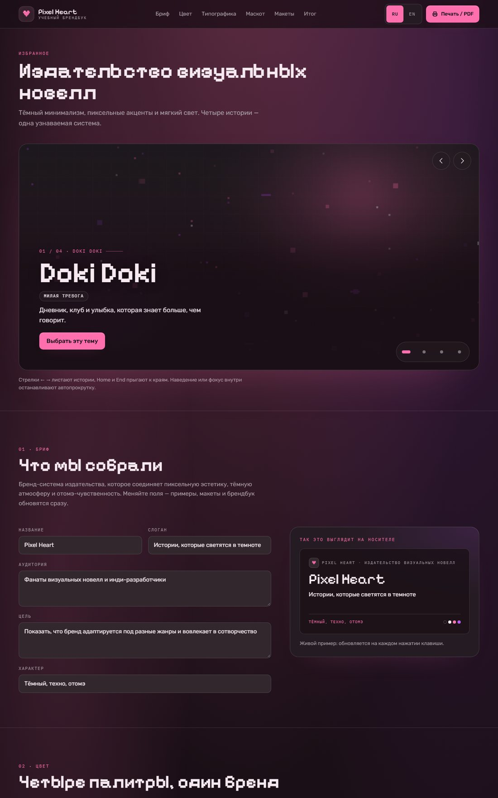
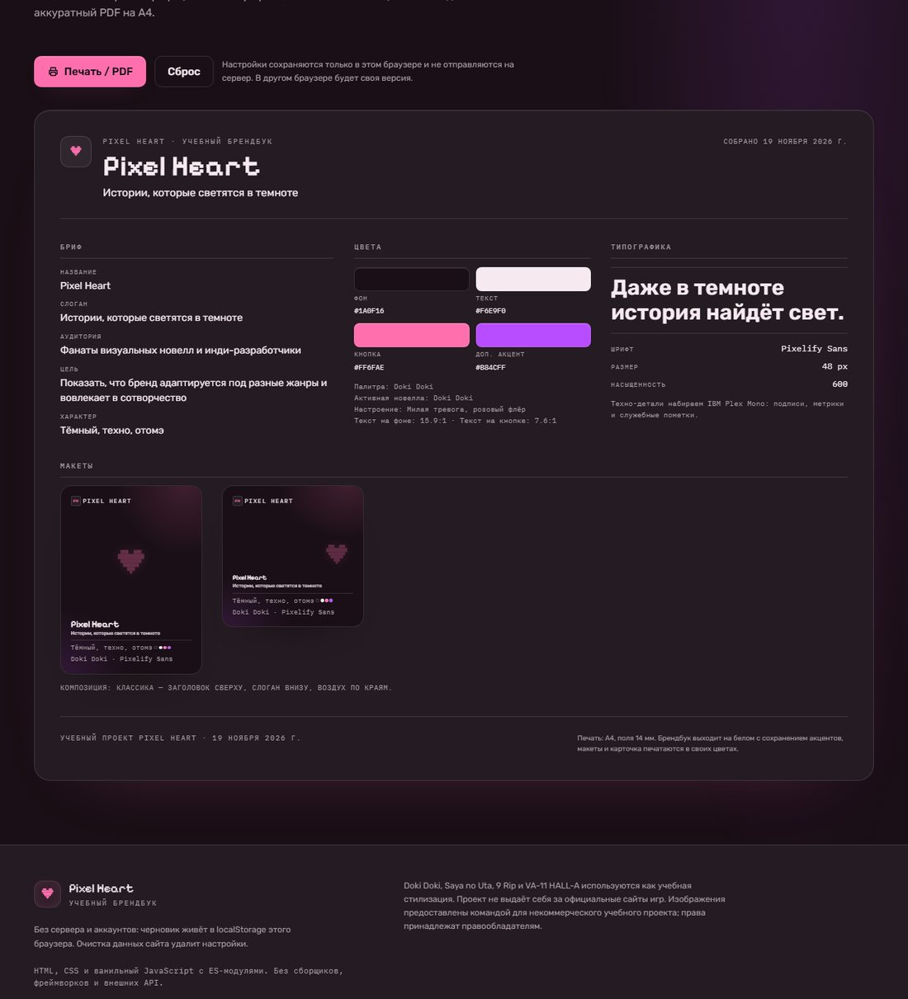
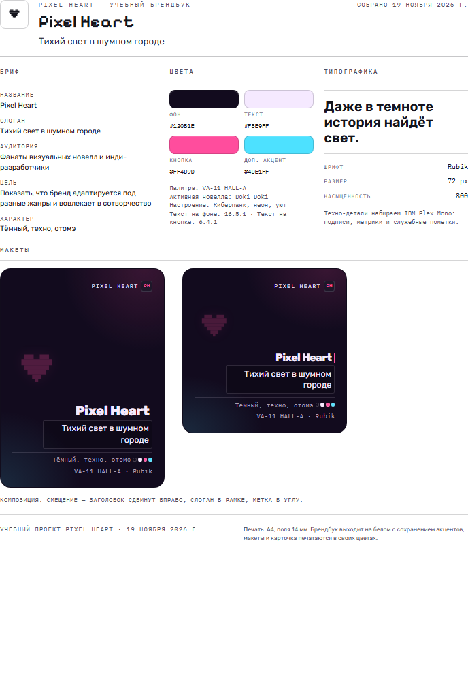

# Pixel Heart — учебный брендбук издательства визуальных новелл

Одностраничный интерактивный брендбук: тёмный минимализм, пиксельные акценты,
четыре палитры-новеллы, маскот, которого можно собрать самому, два макета и
печать на A4.

**Стек:** HTML, CSS, ванильный JavaScript с ES-модулями. Без React, npm,
сборщиков, сервера, регистрации и внешних API. Единственный внешний запрос —
шрифты Google Fonts (Pixelify Sans, Rubik, IBM Plex Mono); у всех есть
локальные fallback-стеки, поэтому сайт работает и без них.

---

## 1. Запуск

ES-модулям нужен `http://`, а не `file://`. Любой статический сервер подойдёт:

```bash
# из корня проекта
python -m http.server 8137
# затем открыть http://localhost:8137/
```

Варианты без Python:

```bash
php -S localhost:8137
# или расширение Live Server в VS Code: правый клик по index.html → Open with Live Server
```

Сборка не нужна: файлы отдаются как есть.

### Публикация на Pages

Пути в проекте относительные, поэтому сайт работает и в подпапке
`https://user.github.io/pixel-heart/`.

- **GitHub Pages:** Settings → Pages → Source: *Deploy from a branch* →
  Branch: `main`, folder `/ (root)` → Save.
- **GitLab Pages:** Settings → Pages → включить, затем добавить `.gitlab-ci.yml`
  с артефактом `public/` (см. фрагмент ниже) и положить туда файлы проекта.
- **GitVerse Pages:** аналогично GitLab — статический артефакт из CI.

```yaml
# .gitlab-ci.yml — минимальный статический деплой
pages:
  stage: deploy
  script:
    - mkdir -p public
    - cp -r index.html css js assets public/
  artifacts:
    paths:
      - public
  only:
    - main
```

Никаких абсолютных путей от корня диска в проекте нет.

---

## 2. Структура файлов

```
pixel-heart/
├── index.html                  # одна страница со всеми секциями и якорями
├── css/
│   ├── common.css              # токены, типографика, шапка, кнопки, поля, подвал
│   ├── hero.css                # карусель, слайды, точки, плейсхолдер
│   ├── brief.css               # форма брифа и живая миниатюра
│   ├── color.css               # карточки палитр, образцы, контраст
│   ├── typography.css          # контролы и живой образец
│   ├── mascot.css              # сцена, карточка, модальный редактор
│   ├── layouts.css             # постер, карточка соцсетей, композиции
│   ├── final.css               # итоговый брендбук
│   └── print.css               # @media print: A4 и режим печати карточки
├── js/
│   ├── data.js                 # новеллы, палитры, шрифты, маскот, композиции, i18n
│   ├── state.js                # demoState, getState/setState/subscribe/resetState
│   ├── storage.js              # localStorage-черновик, debounce, коды статусов
│   ├── theme.js                # палитра → CSS-переменные, расчёт контраста
│   ├── i18n.js                 # t(), pick(), перевод статической разметки
│   ├── utils.js                # escapeHtml, debounce, форматирование, фокус
│   ├── app.js                  # точка входа: загрузка, тема, язык, печать, сброс
│   ├── hero.js                 # карусель: авто, пауза, клавиатура, точки
│   ├── brief.js                # поля брифа, валидация, миниатюра
│   ├── color.js                # выбор палитры, бейджи контраста, мини-пример
│   ├── typography.js           # шрифт, размер, насыщенность, образец
│   ├── mascot.js               # inline SVG маскота, редактор, карточка, печать
│   ├── layouts.js              # постер и карточка соцсетей
│   └── final.js                # итоговый брендбук
├── assets/
│   ├── logo.svg                # самостоятельный пиксельный логотип
│   ├── novels/                 # doki.png, saya.png, nine.png, va11.png + README
│   └── mascot/                 # README со спецификацией слоёв и путями для PNG
├── tools/
│   ├── make-placeholders.py    # генератор временных абстрактных заставок
│   └── verify.mjs              # служебная проверка через CDP (не часть сайта)
├── docs/                       # скриншоты для README
└── README.md
```

`js/theme.js`, `js/utils.js` и папка `tools/` — вспомогательные: первый считает
цвета и контраст, второй содержит общие функции, третий не нужен для работы
сайта и не подключается из `index.html`.

### Как это выглядит





| Мобильный (360 px) | Печать A4 |
| --- | --- |
|  |  |

Скриншоты сняты с демо-данных в Chromium; в них временные абстрактные
заставки новелл.

---

## 3. Как модули обмениваются данными

Единственный источник правды — `js/state.js`. Модули не импортируют друг друга
напрямую (кроме `final.js` → `layouts.js` для отрисовки макетов и
`mascot.js` → `data.js`), не пишут в DOM друг друга и не хранят копий состояния.

```
пользователь
   │  input / change / click / keydown
   ▼
модуль секции (hero, brief, color, typography, mascot, layouts)
   │  setState({ ... })
   ▼
state.js  ── уведомляет всех подписчиков ──────────────┐
   │                                                    │
   ├─► app.js: applyTheme(palette) → CSS-переменные      │
   ├─► hero.js / brief.js / …: перерисовка своей части   │
   ├─► storage.js: save(state) с debounce 200 мс         │
   └─► при lang: translateDom() + перерисовка подписей   │
```

### `state.js`

| Экспорт | Назначение |
| --- | --- |
| `demoState` | демо-данные из ТЗ (плюс флаг `mascotTouched`, см. §12) |
| `getState()` | текущее состояние |
| `setState(patch)` | частичное обновление; `mascot` мержится, числа зажимаются |
| `subscribe(fn)` | подписка на любое изменение; возвращает отписку |
| `subscribeTo(keys, fn)` | подписка только на нужные ключи |
| `resetState()` | возврат к демо с уведомлением обо всех ключах |
| `normalizeState(raw)` | приведение внешних данных к валидной форме |

Подписчик получает `(state, { prev, changed })`, где `changed` — список
изменившихся ключей. Это позволяет не перерисовывать лишнее.

### `storage.js`

- ключ `brandbook-draft`, схема `{ version, updatedAt, state }`;
- `load()` → `{ ok, status, state }`, где `status`: `restored`, `empty`,
  `corrupt`, `unavailable`;
- `save(state)` пишет с debounce **200 мс**, `flushSave()` — сразу
  (на `pagehide` и `visibilitychange`);
- `clear()` удаляет ключ;
- все операции в `try/catch`; при ошибке статус `quota` или `unavailable`;
- `onStorageStatus(fn)` отдаёт коды, а тексты берёт `i18n.js` — поэтому
  сообщения есть на RU и EN и не бывают `alert()`;
- при загрузке данные проходят через `normalizeState`: неизвестные значения
  заменяются демо-значениями, числа зажимаются, битый JSON не роняет сайт.

### Цепочка на примере смены слайда

1. `hero.js` ловит клик/клавишу → `setState({ activeNovelId, paletteId, mascot? })`.
2. `app.js` видит `paletteId` → `applyTheme()` пересчитывает CSS-переменные
   `--theme-*` и контрасты.
3. `color.js` подсвечивает активную палитру, `layouts.js` и `final.js`
   перерисовывают макеты, `mascot.js` обновляет сцену и карточку.
4. `app.js` вызывает `storage.save(state)`; через 200 мс черновик в localStorage.
5. Если пользователь уже менял маскота вручную (`mascotTouched: true`),
   карусель меняет только тему и не трогает его одежду и аксессуар.

---

## 4. Функции

### Hero-карусель
- 4 слайда, горизонтальная лента с плавным `transform`;
- авто-переключение каждые **7000 мс**, пауза при наведении и фокусе внутри,
  возобновление после ухода;
- кнопки назад/вперёд с `aria-label`, точки с `aria-current`, клавиши
  ← → Home End;
- `prefers-reduced-motion` отключает автопрокрутку и плавный сдвиг;
- слайд: изображение, название, жанровый тег, короткое описание, кнопка
  «Выбрать эту тему» (переключает тему и скроллит к брифу);
- смена слайда синхронизирует `activeNovelId` и `paletteId`, обновляет тему и
  вариант маскота (если он ещё не редактировался вручную).

### Бриф
- поля `name`, `slogan`, `audience`, `goal`, `character` с label;
- ввод сразу пишется в состояние и обновляет миниатюру, макеты и итог;
- пустые `name`/`slogan` на blur получают `aria-invalid="true"` и подсказку
  под полем (`role="alert"`, связано через `aria-describedby`);
- длинный текст переносится, контейнеры растягиваются, ничего не обрезается.

### Цвет
- 4 карточки палитр: название, настроение, 4 образца с HEX, бейджи контраста;
- выбор меняет тему сайта, образцы и макеты, но не введённый текст;
- состояние выбора видно текстом («Выбрано» / «Выбрать»), через `aria-checked`
  и акцентную рамку, а не только цветом;
- мини-пример: заголовок, абзац и кнопка в выбранной палитре;
- контрасты считаются в `theme.js` по WCAG и показываются цифрами.

### Типографика
- `previewText` (textarea), `fontId` = `pixelify` | `rubik`, `fontSize` 16–96,
  `fontWeight` 300–800;
- живой образец показывает выбранный шрифт и в заголовке, и в абзаце;
- значения применяются к макетам, карточке маскота и брендбуку.

### Маскот и редактор
- inline SVG из четырёх групп: `data-part="body"`, `outfit`, `head`,
  `accessory` (порядок отрисовки: body → outfit → head → accessory);
- цвета головы и тела — CSS-переменные `--mascot-head` / `--mascot-body`,
  управляются `input type="color"`;
- 6 вариантов одежды и 6 аксессуаров + «без аксессуара»; четыре «новелльных»
  комплекта плюс свободные худи, платье, корона и круглые очки;
- модальный `<dialog>` с фокус-трапом, закрытием по Esc, клику по фону и
  возвратом фокуса на кнопку открытия;
- карточка: лого сверху, маскот, цитата выбранным шрифтом и в цветах палитры;
- «Печать карточки» печатает только карточку, «Сбросить маскота» возвращает
  демо-конфигурацию.

### Макеты
- вертикальный постер 1080 × 1350 и квадратная карточка 1080 × 1080;
- оба показывают название, слоган, палитру и шрифт;
- композиции `classic` и `offset` переключаются одним контролом и сразу видны
  на обоих макетах и в итоговом брендбуке;
- типографика макетов масштабируется через container query units (`cqw`),
  поэтому макет выглядит как уменьшенная копия оригинала 1080 px, а не как
  произвольный текст.

### Итог и печать
- бриф, цвета с HEX, типографика, оба макета, композиция, дата и подпись
  «Учебный проект Pixel Heart»;
- «Печать / PDF» вызывает `window.print()`.

---

## 5. Темы и контраст

| Палитра | Фон | Текст | Акцент | Доп. акцент | Текст/фон | Текст на кнопке |
| --- | --- | --- | --- | --- | --- | --- |
| Doki Doki | `#1A0F16` | `#F6E9F0` | `#FF6FAE` | `#B84CFF` | 15.9:1 | 7.6:1 |
| Saya no Uta | `#0E1410` | `#E6EFE2` | `#B23A3A` | `#7A9E7E` | 15.8:1 | 5.4:1 |
| 9 Rip | `#0A0E1A` | `#E8ECFF` | `#7C5CFF` | `#35D6C4` | 16.4:1 | 4.5:1 |
| VA-11 HALL-A | `#120B1E` | `#F5E9FF` | `#FF4D9D` | `#4DE1FF` | 16.5:1 | 6.4:1 |

Правила, зашитые в `js/theme.js`:

- `--theme-on-accent` выбирается между `#0B0B10` и `#F7F4FA` по фактическому
  контрасту, поэтому тёмная подпись на красном акценте Saya не появляется
  («кнопки — акцентный фон с тёмным текстом» соблюдается там, где это читаемо);
- `--theme-accent-text` — акцент, поднятый по контрасту до 4.5:1 относительно
  фона; он используется для мелких подписей, кикеров и ссылок;
- `--theme-muted` тоже проходит проверку 4.5:1, поэтому приглушённый текст
  остаётся читаемым;
- контрасты пересчитываются при каждой смене палитры, а не хранятся числами.

---

## 6. Маскот: слои и свои PNG

Маскот — самостоятельный пиксельный образ, не копия чужих персонажей.
Разрешение низкое, «спрайтовое»: сетка **20 × 21**, поэтому клетка на экране
крупная, а силуэт читается с первого взгляда.

- **Голова** — ровное пиксельное сердце 14 × 12: круглые доли, неглубокая
  выемка сверху и кончик, который садится на плечи.
- **Лицо** — только два вертикальных глаза 1 × 3; рта, бликов и румянца нет.
- **Тело** — чиби в A-позе: короткий корпус, руки разведены от плеч вниз,
  ноги на ширине корпуса; голова заметно больше тела.
- **Аксессуары** крепятся к долям и «вискам», одежда начинается под кончиком.

Силуэт каждого слоя задан строками сетки `[y, x0, x1)`, а **контур в один
пиксель** считается автоматически: это клетки вокруг силуэта, залитые тёмным
оттенком цвета слоя (`mix(цвет, #0B0B10)`). Голова и тело берут оттенок из
своих цветов, одежда — из палитры темы, поэтому контур живёт вместе с темой,
а цвета головы и тела остаются независимыми. Аксессуары на такой мелкой сетке
рисуются без обводки: в один пиксель она превращала бы бант и корону в тёмные
пятна, поэтому они читаются как плоские цветные наклейки поверх головы.


В коде маскот собран из групп:

```
<g data-part="body">      — тело, руки, ноги, ступни, цвет --mascot-body
<g data-part="outfit">    — одежда: doki | saya | nine | va11 | hoodie | dress
<g data-part="head">      — сердце-голова: доли и глаза; цвет --mascot-head
<g data-part="accessory"> — none | doki | saya | nine | va11 | crown | glasses
```

Лицо минимальное: два глаза шириной в один пиксель, без рта, бликов и румянца.
Одежда и аксессуары используют `var(--theme-accent)` и `var(--theme-accent-2)`,
то есть перекрашиваются вместе с палитрой; голова и тело — отдельные
`input type="color"`, на палитру не завязаны.

Точные пути для своих файлов и требования к слоям — в
[`assets/mascot/README.md`](assets/mascot/README.md). Если команда рисует PNG,
нужны отдельные прозрачные слои 1000 × 1050 px с единой точкой привязки;
сайт заменяет группы `<rect>` на `<image href="assets/mascot/…">` внутри тех же
`data-part`-групп.

Шесть вариантов одежды: свитер с сердцем (`doki`), плащ с капюшоном (`saya`),
школьная форма (`nine`), фартук бармена (`va11`) — по одному на новеллу — плюс
свободные худи (`hoodie`) и платье с рюшами (`dress`). Шесть аксессуаров:
лента с сердцем (`doki`), визор-окуляры (`saya`), звёздная заколка (`nine`),
наушники (`va11`), корона (`crown`) и круглые очки (`glasses`), плюс
«Без аксессуара» (`none`).

Детали одежды: воротники и лацканы, манжеты, пояса с пряжками, карманы и
клапаны, складки юбки, рёбра резинки, шнурки с наконечниками, рюш по подолу.
Детали аксессуаров: тени на крыльях банта и хвостики, линзы с бликами у визора,
штифт заколки, амбушюры и микрофон у наушников, камни на короне, дужки и блики
у очков.

По умолчанию показывается демо-конфигурация из ТЗ: одежда и аксессуар Doki Doki.
Если выбраны свободные (не новелльные) одежда или аксессуар, подпись под сценой
меняется с «Вариант новеллы: …» на «Свободный образ: …». «Сбросить маскота»
возвращает именно демо-конфигурацию.

---

## 7. Печать

Решение по цвету (описано также в подвале PDF-заметки):

- **брендбук** печатается на белом с тёмным текстом `#14141C`; акценты палитры
  сохраняются в образцах, подписях и макетах;
- **постер, карточка соцсетей и карточка маскота** печатаются в собственных
  цветах: для них включён `print-color-adjust: exact`, поэтому тёмные
  поверхности и неон не пропадают;
- A4, поля **14 мм** (`@page { size: A4 portrait; margin: 14mm }`);
- в печати скрыты шапка, навигация, карусель, панель управления, редактор,
  кнопки и тосты; остаётся только итоговый брендбук;
- брендбук собран так, чтобы помещаться на одну страницу A4: три колонки
  (бриф / цвета / типографика), ниже макеты 64 мм, подпись;
- отдельный режим карточки: `body.is-printing-card` + `window.print()`;
  в этом режиме скрыто всё, кроме `.mascot-card`, карточка центрируется и
  печатается целиком без обрезки;
- чтобы получить PDF: «Печать / PDF» → в диалоге печати выбрать
  «Сохранить как PDF». Если фон не нужен, отключите в диалоге печать фона —
  макеты при этом останутся читаемыми за счёт контрастных акцентов.

Проверено в Chromium: PDF брендбука — 1 страница, PDF карточки — 1 страница.

---

## 8. Доступность и адаптивность

- семантические `header`, `nav`, `main`, `section`, `footer`, `fieldset/legend`;
- все интерактивные элементы доступны с Tab и работают по Enter/Space;
- видимый фокус через `:focus-visible` (тонкое кольцо акцентного цвета),
  `outline` не убирается без замены;
- `aria-label`, `aria-labelledby`, `aria-checked`, `aria-invalid`,
  `aria-current`, `aria-describedby`, `aria-live` для сообщений и карусели;
- модальный редактор: `role="dialog"`, `aria-modal="true"`, фокус-трап,
  возврат фокуса, закрытие по Esc;
- изображения: контентные — с `alt`, декоративные — `alt=""`; маскот имеет
  `<title>` и `role="img"`;
- ширины 360 px и 1280 px проверены: горизонтального переполнения нет,
  кнопки и поля не меньше 44 × 44 px;
- при 200 % масштабе заголовки и макеты не обрезаются;
- `prefers-reduced-motion` отключает автопрокрутку, плавный сдвиг и анимацию
  маскота; `prefers-color-scheme` не используется — сайт тёмный по концепции.

---

## 9. Хранение и приватность

- ключ `localStorage`: **`brandbook-draft`**;
- сохранение при каждом изменении состояния с debounce 200 мс;
- восстановление при загрузке страницы;
- битый JSON → демо-данные + сообщение в интерфейсе (не `alert`);
- недоступное хранилище (приватный режим, запрет cookies) → сайт работает,
  сообщение объясняет, что настройки не сохранятся;
- «Сброс» возвращает демо и удаляет ключ;
- рядом с сохранением и в подвале текст: «Настройки сохраняются только в этом
  браузере и не отправляются на сервер. В другом браузере будет своя версия».

Сайт не отправляет данные никуда, кроме запроса шрифтов на
`fonts.googleapis.com` / `fonts.gstatic.com`. Аккаунтов, синхронизации и
серверной части нет и не подразумевается.

---

## 10. Языки RU / EN

- переключатель в шапке, состояние `lang` живёт в `state.js`;
- все подписи, подсказки, кнопки, названия секций, ошибки и `aria-label` —
  из словаря `I18N` в `js/data.js`, доступ через `t()` / `pick()`;
- пользовательский ввод (`name`, `slogan`, `audience`, `goal`, `character`,
  `previewText`, `quoteText`) не переводится и сохраняется как есть;
- демо-тексты бренда живут в `DEMO_COPY` (RU/EN). Если пользователь ещё не
  менял `name`/`slogan`, переключатель подставляет демо-слоган другого языка
  («Истории, которые светятся в темноте» ↔ “Stories that glow in the dark”);
  как только текст отличается от демо, он не трогается;
- при переключении обновляются `<html lang>`, `<title>`, meta-description и
  `og:locale`, перерисовываются макеты, брендбук, редактор и карусель.

---

## 11. Ассеты: куда класть свои файлы

| Что | Точный путь | Примечание |
| --- | --- | --- |
| Логотип | `assets/logo.svg` | самостоятельный пиксельный знак, не копия чужих логотипов |
| Doki Doki | `assets/novels/doki.png` | 1600 × 1000, 16:10, PNG/WebP |
| Saya no Uta | `assets/novels/saya.png` | то же |
| 9 Rip | `assets/novels/nine.png` | то же |
| VA-11 HALL-A | `assets/novels/va11.png` | то же |
| Маскот, голова-сердце | `assets/mascot/head.png` | 1000 × 1050, прозрачность |
| Маскот, тело | `assets/mascot/body.png` | 1000 × 1050 |
| Одежда | `assets/mascot/outfit-doki.png`, `outfit-saya.png`, `outfit-nine.png`, `outfit-va11.png`, `outfit-hoodie.png`, `outfit-dress.png` | 1000 × 1050 |
| Аксессуары | `assets/mascot/accessory-none.png`, `accessory-doki.png`, `accessory-saya.png`, `accessory-nine.png`, `accessory-va11.png`, `accessory-crown.png`, `accessory-glasses.png` | 1000 × 1050 |

Что уже лежит в репозитории:

- `assets/novels/*.png` — **временные абстрактные заглушки** 1200 × 800,
  сгенерированные скриптом `tools/make-placeholders.py` (тёмный градиент,
  свечение, сетка и звёзды в цветах палитры). Это не кадры из игр; замените их
  своими изображениями по тем же путям.
- Если файла нет, `hero.js` показывает аккуратный SVG-плейсхолдер с названием
  новеллы и подписью «Положите файл: `assets/novels/…`» — сайт не ломается.

Перегенерировать заглушки:

```bash
python tools/make-placeholders.py   # нужен Pillow
```

---

## 12. Решения и известные упрощения

- **`mascotTouched`** добавлен в состояние сверх ТЗ: без него карусель не может
  одновременно менять вариант маскота и не затирать ручную настройку. На
  `demoState` это не влияет — все ключи из ТЗ на месте.
- **Кнопки**: базовое правило «акцентный фон + текст `#0B0B10`» сохранено, но
  для палитры Saya тёмный текст на `#B23A3A` даёт 3.3:1. Поэтому цвет подписи
  выбирается автоматически (`--theme-on-accent`), а цифры контраста показаны
  в секции «Цвет». Это осознанное отступление ради читаемости.
- **Дисплейный шрифт** Pixelify Sans используется в логотипе, названиях новелл,
  заголовках и макетах; длинные абзацы интерфейса набраны Rubik.
- **Макеты** — уменьшенные копии макетов 1080 px: размеры считаются в `cqw`,
  поэтому настройки типографики видно пропорционально, а не «как получится».
- **Печать на белом** для брендбука и в цвете для макетов — решение описано
  в §7.
- **Внешние шрифты** грузятся с Google Fonts; без сети включаются fallback-стеки
  (`system-ui`, `ui-monospace`), вёрстка не ломается.

---

## 13. Команда и git

Команда из двух человек; у каждого своя содержательная часть и свой слитый
PR/MR в `main`.

| Участник | Зона ответственности | Ветка |
| --- | --- | --- |
| **A — лид** | каркас, шапка, навигация, hero-карусель, бриф, цвет, `state/storage/data/i18n`, `common.css`, публикация Pages | `feature/lead-brief-hero-color` |
| **B** | типографика, маскот и редактор, карточка маскота, два макета и выбор композиции, итоговый брендбук, печать | `feature/typography-mascot-print` |

Порядок работы:

```bash
# лид создаёт репозиторий и общий каркас
git init
git add .
git commit -m "chore: каркас брендбука, шапка, hero, бриф, цвет, state/storage"
git branch -M main
git remote add origin <repo-url>
git push -u origin main

# каждый участник клонирует и создаёт личную ветку от актуальной main
git clone <repo-url>
cd pixel-heart
git checkout -b feature/typography-mascot-print
```

Содержательные коммиты под своим именем:

```bash
git add js/typography.js css/typography.css
git commit -m "feat(typography): живой образец, размер и насыщенность"

git add js/mascot.js css/mascot.css index.html
git commit -m "feat(mascot): inline SVG, редактор с фокус-трапом и карточка"

git add js/layouts.js css/layouts.css js/final.js css/final.css css/print.css
git commit -m "feat(layouts): постер, карточка соцсетей, композиции и печать A4"

git push -u origin feature/typography-mascot-print
```

Правила:

1. Каждый работает в своих файлах; общие (`index.html`, `css/common.css`,
   `js/state.js`, `js/data.js`, `js/app.js`) меняются по договорённости.
2. PR A проверяет B, PR B проверяет A.
3. Слияние — **merge commit**, чтобы сохранить личные коммиты:
   `git merge --no-ff feature/typography-mascot-print`.
4. После каждого слияния прогоняется весь сценарий (см. §14), а не только
   личный экран.
5. Публикация — через Pages после зелёного сценария на `main`.
6. Пустые слияния ради количества PR не делаются; заменять чужие секции при
   доработках нельзя.

---

## 14. Чек-лист ручной проверки

| № | Что проверить | Ожидаемо |
| --- | --- | --- |
| 1 | Первое открытие | видны демо-данные, карусель листается, тема меняется при смене слайда |
| 2 | Изменить `name` и `slogan` | сразу обновляются миниатюра, оба макета и итог |
| 3 | Очистить `name`, уйти из поля | подсказка под полем, `aria-invalid="true"`, интерфейс не перекрыт |
| 4 | Выбрать каждую из 4 палитр | меняются фон, текст и акцент; бейджи контраста ≥ 4.5:1 |
| 5 | Оба шрифта, размер, насыщенность | образец, заголовок, макеты и брендбук обновляются |
| 6 | Маскот: одежда, аксессуар, цвета, цитата | сцена и карточка меняются; цитата — выбранным шрифтом и цветами |
| 7 | «Печать карточки» | печатается только карточка, без обрезки |
| 8 | Переключить композицию | меняются оба макета и итог |
| 9 | «Печать / PDF» | панель управления скрыта, бриф и оба макета видны, A4, поля 14 мм |
| 10 | Обновить страницу | настройки восстановились в этом браузере |
| 11 | «Сброс» | демо-данные, ключ `brandbook-draft` удалён |
| 12 | Повреждённое/недоступное хранилище | сообщение в интерфейсе (не `alert`), сайт работает |
| 13 | 360 px, 1280 px, 200 %, клавиатура | ничего не обрезается, фокус видим, сценарий проходим |
| 14 | Другой браузер | настройки не появляются — это написано рядом с сохранением |

Проверено на сборке: все 14 пунктов, плюс автоматический прогон — **47 из 47
проверок**. Скриншоты и PDF — в `.preview/` (папка создаётся скриптом проверки
и не входит в поставку).

### Автоматическая проверка (необязательно)

`tools/verify.mjs` управляет headless Chromium по CDP: точные viewport’ы
360/1280, сценарии приёмки, печать в PDF, скриншоты. Нужен Node 22+ и браузер
Chromium/Edge:

```bash
# 1) статический сервер
python -m http.server 8137

# 2) браузер с отладочным портом (в отдельном окне)
msedge --headless=new --remote-debugging-port=9222 --user-data-dir=/tmp/pixel-heart about:blank

# 3) прогон
node tools/verify.mjs
```

Скрипт не подключается к сайту и не нужен для его работы.

---

## 15. Использованные промпты и фактический результат

**Промпт 1 — постановка.** «Сделай законченный учебный сайт-брендбук
издательства визуальных новелл Pixel Heart на чистых HTML, CSS и ванильном JS
с ES-модулями: четыре палитры, hero-карусель, бриф, типографика, маскот с
редактором, два макета, итог и печать A4. Без React, npm, сборщиков, сервера и
внешних API».

**Результат:** собраны все файлы из ТЗ, `state.js`/`storage.js`/`data.js`/
`i18n.js` связали секции, тема меняется от палитры, маскот редактируется и
печатается отдельной карточкой, брендбук печатается на одну A4.

**Промпт 2 — доводка вёрстки.** «Стрелки карусели перекрывают номер слайда;
перенеси их в правый верхний угол. Макеты выглядят пустыми — добавь пиксельное
сердце и увеличь заголовок, чтобы постер читался как постер. На мобильном
цитата карточки упирается в кавычку — убери наложение».

**Результат:** стрелки перенесены, у макетов появилась графика и крупная
типографика, цитата получила акцентную линию слева и перестала пересекаться с
декором.

**Промпт 3 — проверка.** «Проверь сборку как приёмку: 360 и 1280 px, пустое
обязательное поле, все палитры и контраст, шрифты, маскот, композиции, печать
брендбука и карточки, сохранение и битое хранилище».

**Результат:** найдены и исправлены: кнопки ниже 44 px, ложный тест на
недоступное хранилище, обрезка печатной версии на вторую страницу. Итог —
47/47 автоматических проверок, PDF брендбука и карточки по одной странице.

---

## 16. Права и оговорка

Doki Doki, Saya no Uta, 9 Rip и VA-11 HALL-A используются как учебная
стилизация. Проект не выдаёт себя за официальные сайты игр и не аффилирован с
правообладателями. Изображения предоставлены командой для некоммерческого
учебного проекта; права принадлежат правообладателям. Маскот Pixel Heart —
самостоятельный образ, не копия чужих персонажей. Логотип и вёрстка также
самостоятельные; Dropbox и его айдентика не использовались.

Настройки хранятся только в `localStorage` этого браузера и никуда не
отправляются. В другом браузере будет своя версия брендбука.
